

  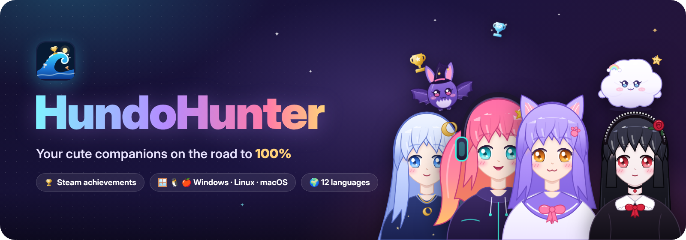

  
  
  
  
  

  <a href="README.md">English</a> · <a href="README.tr.md">Türkçe</a> · <a href="README.ru.md">Русский</a> · <a href="README.es.md">Español</a> · <a href="README.zh.md">中文</a> · <b>Deutsch</b> · <a href="README.fr.md">Français</a> · <a href="README.ja.md">日本語</a>

---

  

**HundoHunter** ist ein kleines Overlay, das beim Spielen in einer Bildschirmecke sitzt. Es erkennt dein laufendes Steam-Spiel und zeigt dir, **welchen Erfolg du als Nächstes holen solltest**, **wie du ihn bekommst** und **welche du für immer verpassen könntest**. Ein Ziel: jedes Spiel auf 100 % – ein *Hundo*.

Und du jagst nie allein. Darf ich vorstellen: die **Hundos** 💖

  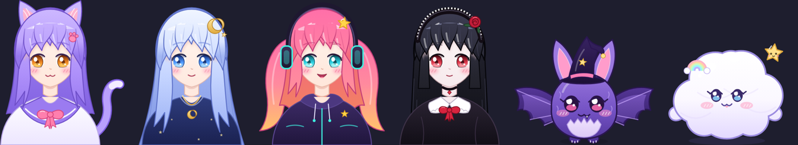

## 🆕 Neu in v4.2

<h3>🎁 Dein Jahr, dein Rang</h3>

<table>
<tr>
<td width="44%" valign="top">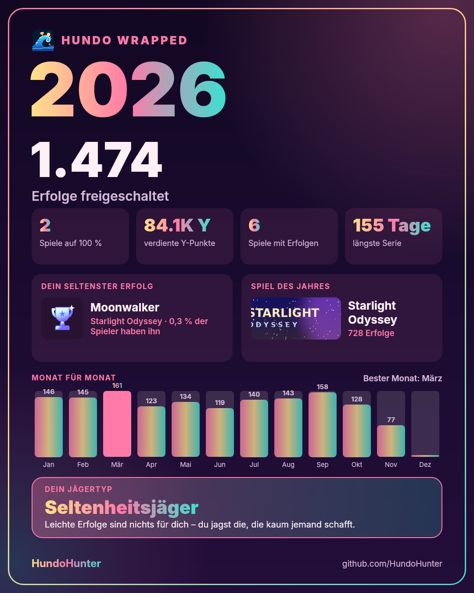</td>
<td valign="top">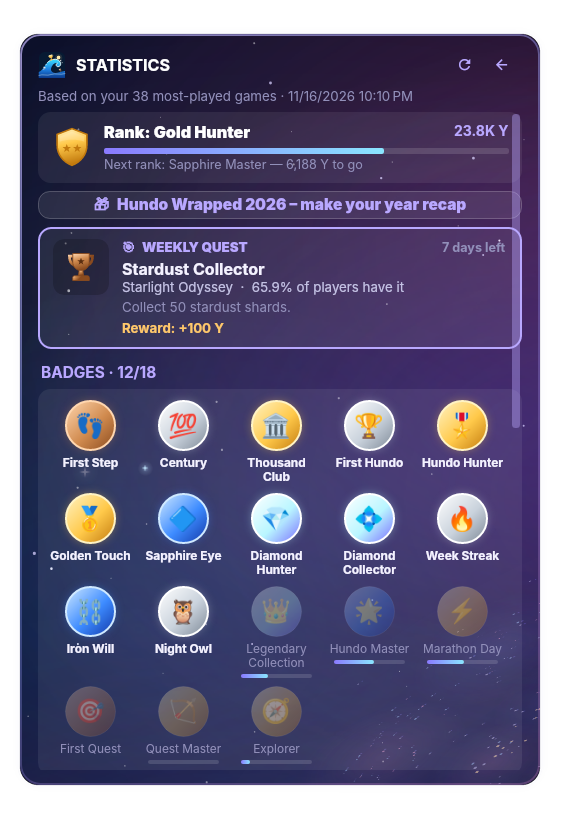
<ul>
<li><b>Hundo Wrapped</b>: ein Jahresrückblick (1080×1350) mit Erfolgen, 100 %-Spielen, seltenstem Erfolg, Spiel des Jahres, Monatsgrafik und deinem Jägertyp.</li>
<li><b>Abzeichen und Rangfortschritt</b>: 18 Abzeichen mit Fortschrittsbalken und wie weit es noch bis zum nächsten Rang ist.</li>
<li><b>Wochenquest</b>: ein seltener, aber machbarer Erfolg aus einem deiner Spiele; +100 Y, wenn du ihn in der Woche schaffst.</li>
<li><b>„Fast geschafft“-Hinweise</b> bei Fortschrittserfolgen und eine <b>Schätzung bis 100 %</b> nach deinem eigenen Tempo.</li>
</ul>
</td>
</tr>
</table>

<h3>📺 Streamer-Modus & zweiter Bildschirm</h3>

  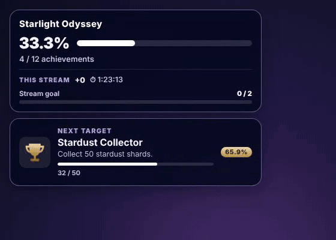

<table>
<tr>
<td width="66%" valign="top">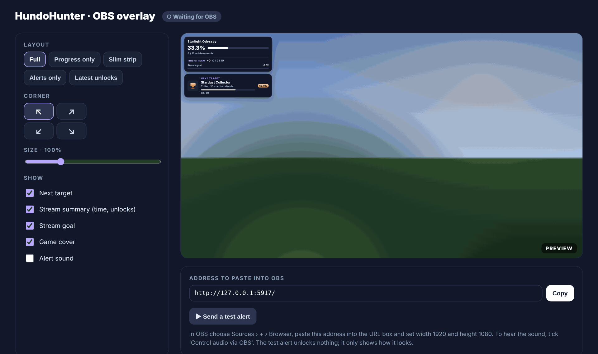
<ul>
<li><b>Streamer-Modus überarbeitet</b>: neues OBS-Overlay mit Einrichtungs- und Vorschauseite, Stream-Ziel, Meldungen in Trophäenfarbe mit Konfetti, Test-Meldung und <b>Twitch-Chat-Befehle</b> (<code>!target</code>, <code>!progress</code>, <code>!rarest</code>).</li>
<li><b>Posts in einen Discord-Kanal</b> per Webhook: seltene Erfolge, alle oder nur 100 %, mit Teilen-Karte.</li>
</ul>
</td>
<td valign="top">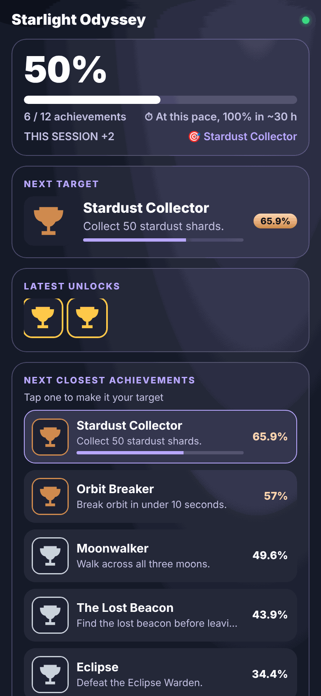
<ul>
<li><b>Handy als zweiter Bildschirm</b>: QR-Code scannen, schon zeigt das Handy das HUD; tippe auf einen Erfolg, um ihn anzuvisieren. Nur im eigenen Netz und mit geheimem Schlüssel.</li>
</ul>
</td>
</tr>
</table>

<h3>✨ Außerdem</h3>

<ul>
<li><b>Drei neue Pixel-Art-Themes</b> mit handgezeichneten Animationen, die kleine Geschichten erzählen: Glut und Stahl, Mondteich und Sternenwanderer.</li>
<li>Eine neue <b>Startanimation</b>: Eine durchscheinende Welle bringt die Pokale und schreibt den Namen. Animationen laufen jetzt mit <b>60 fps</b>, dazu eine schmale Scrollleiste in Themefarbe.</li>
<li><b>Update mit einem Klick</b> in den Einstellungen und flüssigere Animationen in allen Themes.</li>
</ul>

## 🕹️ Drei neue Pixel-Themes

Handgezeichnete Pixel-Art, jedes mit einer kleinen Geschichte, die sich alle paar Sekunden wiederholt.

<table>
<tr>
<td width="33%" align="center" valign="top">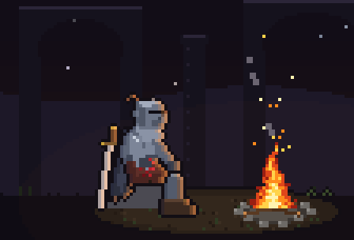 <b>Glut und Stahl</b> Ein verwundeter Ritter ruht an einem Lagerfeuer, in dessen Flammen ein Schwert steckt.</td>
<td width="33%" align="center" valign="top">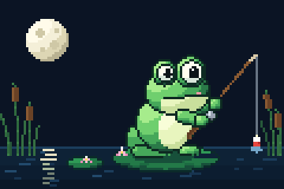 <b>Mondteich</b> Ein Frosch am Teich im Mondlicht, Glühwürmchen und springende Fische.</td>
<td width="33%" align="center" valign="top">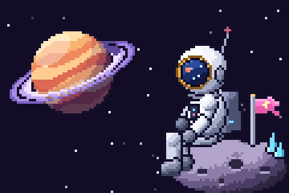 <b>Sternenwanderer</b> Ein kleiner Astronaut hisst seine Flagge auf einem treibenden Felsen.</td>
</tr>
</table>

## 💖 Lerne die Hundos kennen

Die Hundos sind die kleinen Mädchen, die in den Themes von HundoHunter wohnen. Sie blinzeln, wiegen sich, wedeln mit dem Schwanz und **springen vor Freude, jedes Mal wenn du einen Erfolg freischaltest**. Jede hat ihre Lieblingsaufgabe:

<table>
<tr>
<td width="200" align="center">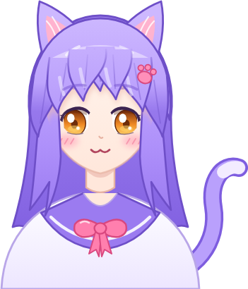 <b>Neko</b></td>
<td>
<b>Die Spürnase.</b> Neko wittert deinen <b>nächsten Erfolg</b>, sobald ein Spiel startet – mit Beschreibung und Guide-Tipp. Ihre Ohren zucken, wenn etwas nah ist (z. B. Fortschrittserfolge wie <code>32/50</code>).
  <i>"Nyaa~ nur noch drei, dann gehört er dir!"</i>
</td>
</tr>
<tr>
<td width="200" align="center">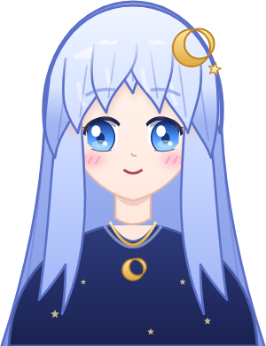 <b>Mondschein</b></td>
<td>
<b>Die stille Hüterin.</b> Mondschein wacht über deine <b>Bibliothek</b>, deinen <b>14-Tage-Verlauf</b> und die Spiele, die <b>am nächsten an 100 %</b> sind – so weißt du immer, welcher Hundo in Reichweite ist.
  <i>"Stardew Valley steht bei 86 %... machen wir es heute Abend fertig?"</i>
</td>
</tr>
<tr>
<td width="200" align="center">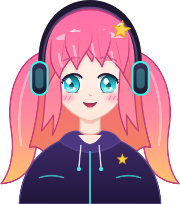 <b>Neon-Rhythmus</b></td>
<td>
<b>Die Cheerleaderin.</b> Wenn ein Erfolg aufploppt, weiß sie es zuerst: <b>sofortige Erkennung</b>, in derselben Sekunde wie Steams eigene Benachrichtigung. Trophäen-Sound, Hinweis, ein Sprung – und dein <b>Y-Score</b> steigt.
  <i>"Diamant-Trophäe!! Weniger als 1 % der Spieler haben die!"</i>
</td>
</tr>
<tr>
<td width="200" align="center">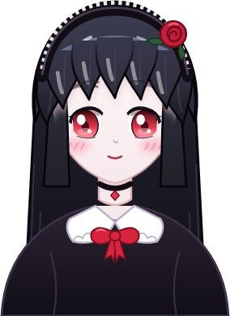 <b>Gothic-Prinzessin</b></td>
<td>
<b>Die Wächterin.</b> Sie warnt dich vor <b>verpassbaren Erfolgen</b>, bevor es zu spät ist (KI-gestützte Erkennung), und hält <b>versteckte Erfolge verschwommen</b>, damit nichts gespoilert wird.
  <i>"Vorsicht. Wenn du dieses Kapitel verlässt, ist die Trophäe für immer weg."</i>
</td>
</tr>
</table>

Und ihre zwei kleinen Maskottchen-Freunde:

<table>
<tr>
<td width="200" align="center">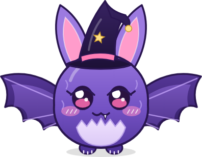 <b>Mitternachtsfledermaus</b></td>
<td>
<b>Die Nachteule.</b> Sie begleitet das <b>Stream-Overlay</b>: Zielbalken, LIVE-Abzeichen und Konfetti-Alerts für deine Zuschauer.
  <i>"Chat, habt ihr das gesehen? Saphir-Pokal!"</i>
</td>
</tr>
<tr>
<td width="200" align="center">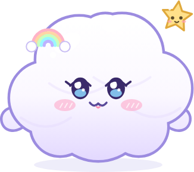 <b>Wattewölkchen</b></td>
<td>
<b>Die Träumerin.</b> Wattewölkchen schwebt über deiner <b>Statistik</b>: Abzeichen, Wochenquest und am Jahresende dein <b>Hundo Wrapped</b>.
  <i>"Nur noch 4 Abzeichen... das schaffen wir~"</i>
</td>
</tr>
</table>

## ✨ Funktionen

<table>
<tr>
<td width="50%" valign="top">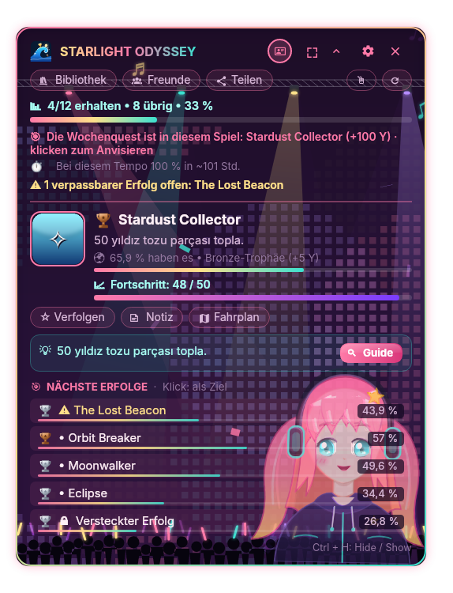</td>
<td valign="top">
<h3>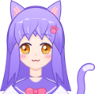 Guide im Spiel</h3>
<ul>
<li>Erkennt das laufende Steam-Spiel automatisch</li>
<li><b>Nächster Zielerfolg</b> mit Beschreibung, Seltenheit und Guide-Tipp</li>
<li><b>Nächstgelegene Erfolge</b> mit Seltenheitsbalken</li>
<li>Verfolge beliebige Erfolge als Ziel und füge Notizen hinzu</li>
<li>Funktioniert über Spielen im <b>randlosen Fenster / Fenster-Vollbild</b></li>
</ul>
<h3> Sofortige Freischaltungen</h3>
<ul>
<li>Liest Steams eigene lokale Daten: Erfolge erscheinen <b>in derselben Sekunde wie bei Steam</b></li>
<li>Funktioniert auch, wenn deine <i>Spieldetails</i> privat sind</li>
<li>Offline-Cache: funktioniert auch ohne Internet</li>
</ul>
</td>
</tr>
<tr>
<td valign="top">
<h3>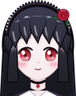 Keine Überraschungen, keine Spoiler</h3>
<ul>
<li>Warnungen vor <b>verpassbaren Erfolgen</b> (KI-gestützt: Gemini oder OpenAI)</li>
<li>Guide-Texte werden <b>automatisch übersetzt</b></li>
<li><b>Spoiler-Schutz</b>: versteckte Erfolge bleiben verschwommen, bis du willst</li>
</ul>
<h3>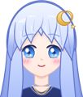 Deine ganze Sammlung</h3>
<ul>
<li>Bibliothek mit dem Fortschritt jedes Spiels und den Spielen <b>am nächsten an 100 %</b></li>
<li>14-Tage-Diagramm deiner Freischaltungen</li>
<li><b>Freundesvergleich</b> und Freunde-Rangliste</li>
<li>Mehrere Steam-Konten, Wechsel mit einem Klick</li>
</ul>
</td>
<td valign="top">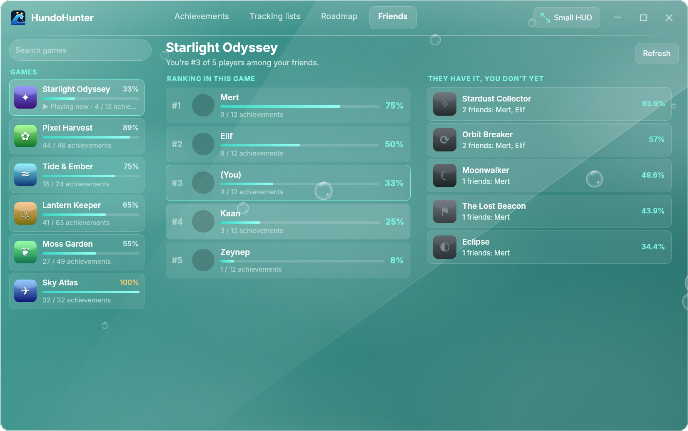</td>
</tr>
</table>

  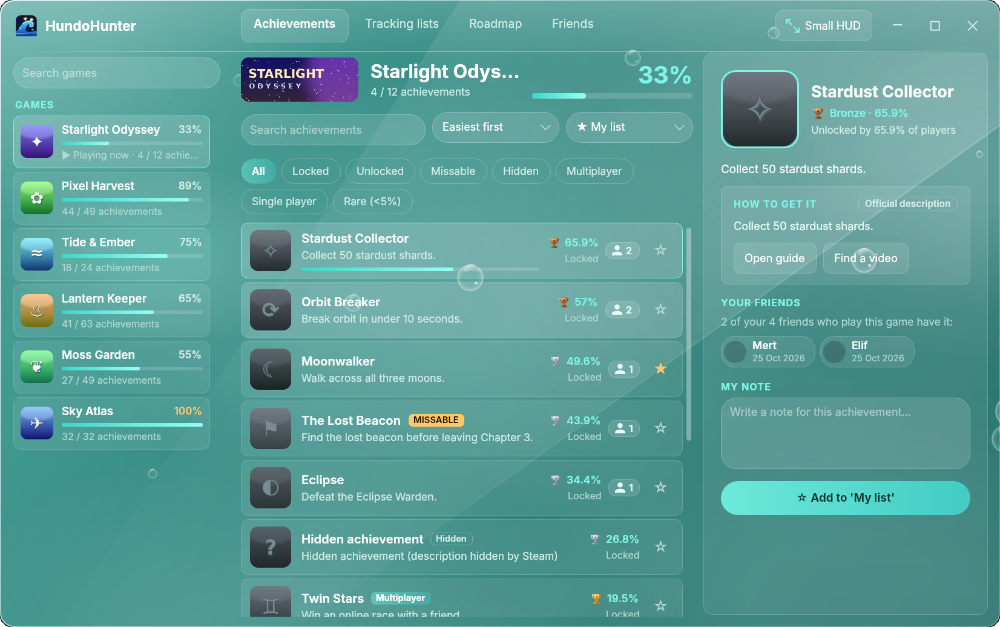

## 🏆 Trophäenstufen & Y-Score

Jeder Erfolg bekommt eine Stufe, je nachdem wie viele Spieler ihn freigeschaltet haben – und jede Stufe hat ihren eigenen Sound.

| | Stufe | Freigeschaltet von | Punkte |
|:-:|---|---|--:|
|  | **Bronze** | 50 % und mehr | 5 |
|  | **Silber** | 20 % – 50 % | 15 |
|  | **Gold** | 5 % – 20 % | 40 |
|  | **Saphir** | 1 % – 5 % | 100 |
|  | **Diamant** | unter 1 % | 250 |

Schließe ein Spiel zu 100 % ab für einen **Bonus von +50**. Steig im Rang auf: Neuling → Bronze-Jäger → Silber-Jäger → Gold-Jäger → Saphir-Meister → Diamant-Meister → **Legende**.

## 🎨 35 Themes (und ein paar geheime)

Die meisten Themes sind animiert. Die Hundos wohnen in **Neko**, **Mondschein**, **Neon-Rhythmus** und **Gothic-Prinzessin**, und sie haben auch Maskottchen-Freunde. Du kannst sogar **dein eigenes Hintergrundbild** setzen – zusammen mit einem Theme oder allein.

  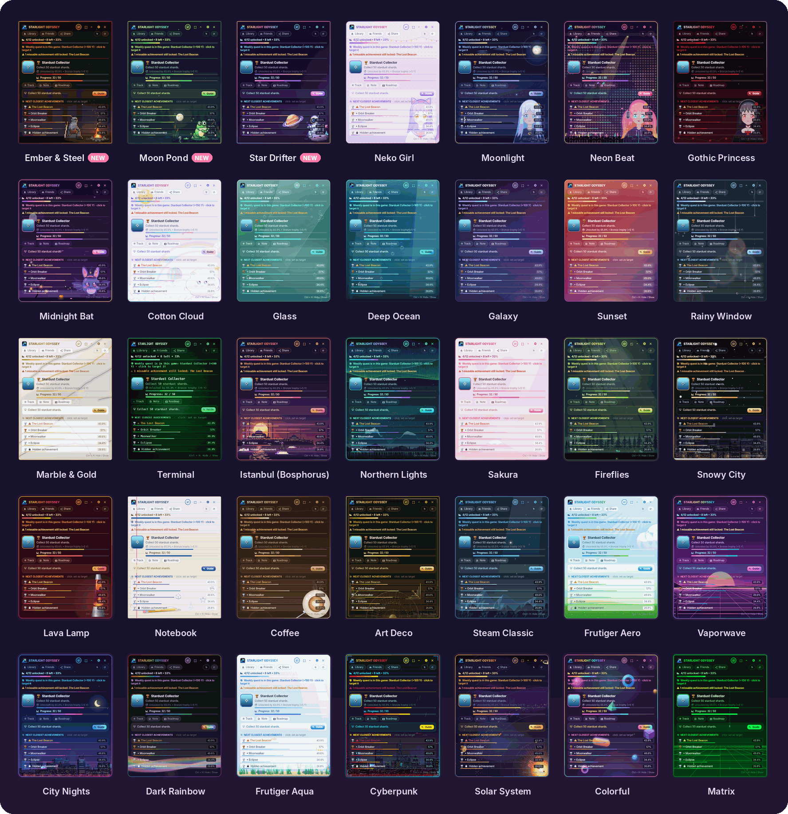

> 🤫 Manche Themes stehen nicht in der Liste. Man munkelt, die Hundos flüstern die Passwörter nur echten Jägern zu...

## 📥 Download & Einrichtung

1. 🪟 **Windows:** Lade **HundoHunter.zip** aus dem [neuesten Release](../../releases/latest) herunter und entpacke es irgendwo.
2. Starte `HundoHunter.exe`. Sonst musst du nichts installieren: es ist eine einzelne Datei mit .NET an Bord. *Windows zeigt eventuell „Der Computer wurde durch Windows geschützt“, weil die App nicht signiert ist. Klicke auf **Weitere Informationen → Trotzdem ausführen**.*
   - 🐧 **Linux:** Lade `HundoHunter-4.2.0-linux-x64.tar.gz` herunter, entpacke es und starte `./install.sh` (fügt HundoHunter zu deinem App-Menü hinzu). Läuft am besten in einer X11-Sitzung; unter Wayland hängen Tastenkürzel und „immer im Vordergrund“ von deinem Desktop ab.
   - 🍎 **macOS:** Lade die ZIP für deinen Mac herunter (`AppleSilicon` für M1–M4, `Intel` für ältere Macs), entpacke sie und verschiebe `HundoHunter.app` in „Programme“. Die App ist nicht signiert: Beim ersten Mal Rechtsklick und **Öffnen** wählen.
   - 🎮 **Steam Deck:** Nutze die Linux-Version. Im Spielmodus wird das kleine HUD über dem Spiel gezeichnet und lässt sich per Controller ein- und ausblenden. Das große Fenster ist auf dem Steam Deck nicht verfügbar.
3. Hol dir einen kostenlosen **Steam-Web-API-Schlüssel** unter <https://steamcommunity.com/dev/apikey> (jeder Domainname geht, z. B. `localhost`) und füge ihn in den Einstellungen ein.
4. Füge dein Konto hinzu: Link zu deinem Steam-Profil, eigene URL oder 17-stellige Steam-ID.
5. *(Optional)* Füge einen **Google-Gemini**- (mit kostenlosem Kontingent) oder **OpenAI**-Schlüssel hinzu, für Verpassbar-Erkennung und Guide-Übersetzung.
6. Klicke auf **Speichern & Starten**, starte ein Spiel über Steam und sag deiner Hundo Hallo.

> 💡 Für Bibliothek, Verlauf und Freunde stelle **Steam → Profil bearbeiten → Privatsphäre → Spieldetails** auf **Öffentlich**.

### Tastenkürzel

| Tasten | Aktion |
|---|---|
| `Strg` + `H` | Overlay ein- / ausblenden |
| `Strg` + `Shift` + `H` | Durchklick-Modus (Klicks gehen ans Spiel) |
| `Ctrl` + `Shift` + `A` | Großes Fenster öffnen |
| `Ctrl` + `1` … `4` | Tabs im großen Fenster wechseln |

Alle Kürzel lassen sich in den Einstellungen ändern. Kompaktmodus und Aktualisieren haben standardmäßig keine Taste. Das Overlay lässt sich auch per Controller ein- und ausblenden.

## 🔒 Datenschutz

- API-Schlüssel werden nur für dein Konto verschlüsselt (Windows DPAPI unter Windows, unter Linux und macOS eine private Schlüsseldatei, die nur du lesen kannst).
- Steams lokale Statistikdateien werden nur **gelesen**, nie verändert.
- Dein Hintergrundbild bleibt auf deinem PC; nur sein Speicherort wird gemerkt.
- Keine Telemetrie. HundoHunter spricht nur mit Steam, dem gewählten KI-Dienst, dem Übersetzungsdienst und GitHub (für die Update-Prüfung).
- Die Stream-Overlay-Seite lässt sich nur auf deinem eigenen Computer öffnen (127.0.0.1).
- Screenshots und Teilen-Karten werden in deinem Bilder-Ordner gespeichert; nichts wird hochgeladen.
- Der Discord-Status ist optional und läuft nur über die Discord-App auf deinem Computer.
- Die Fehlermeldung öffnet ein GitHub-Issue, das du vor dem Absenden lesen kannst. API-Schlüssel, Steam-IDs, E-Mail-Adressen und dein Benutzername werden unkenntlich gemacht.
- Die Handy-Seite funktioniert nur in deinem eigenen Netzwerk und braucht den geheimen Schlüssel aus dem QR-Code.
- Deine Discord-Webhook-Adresse wird verschlüsselt gespeichert, wie deine API-Schlüssel.
- Der Twitch-Chat wird anonym und nur lesend gelesen; HundoHunter schreibt nie in deinen Chat.

## ❓ Fehlerbehebung

| Problem | Versuch das |
|---|---|
| Nicht über dem Spiel sichtbar | Stell das Spiel auf **randloses Fenster / Fenster-Vollbild**. Exklusiver Vollbildmodus kann keine anderen Fenster zeigen. |
| Erfolge können nicht gelesen werden | Stimmt dein API-Schlüssel? Sind die *Spieldetails* öffentlich? |
| Freischaltungen erscheinen verspätet | Läuft Steam und hast du das Spiel über Steam gestartet? |
| Falsches Spiel erkannt | Trage die AppID des Spiels (die Zahl im Store-Link) unter *Spiel manuell wählen* ein. |
| Overlay verschwunden | Drücke `Strg` + `H` oder klicke auf das Tray-Symbol. |
| Handy-Seite öffnet nicht | Das Handy muss im selben WLAN sein; erlaube HundoHunter in der Firewall (private Netzwerke). |
| Discord-Posts erscheinen nicht | Nutze <b>Test senden</b> in den Einstellungen; prüfe, ob die Webhook-URL vollständig ist und der Kanal noch existiert. |

## 💝 HundoHunter unterstützen

HundoHunter ist kostenlos und mit Liebe gemacht. Wenn es dir zu einem Hundo verholfen hat, kannst du den Hundos eine Leckerei spendieren! Jede Unterstützung bringt neue Themes, Funktionen und Hundos.

  
  

<b>Früher: Was in v4.1 kam</b>

- **Das große Fenster** (`Ctrl` + `Shift` + `A`): alle deine Spiele und Erfolge nebeneinander, mit Filtern, Sortierung, Guides, Notizen und Freunden. Die Suche findet jedes Spiel, das du besitzt, auch nie gestartete, und verzeiht Tippfehler.
- **Trackinglisten**: sammle Erfolge aus beliebigen Spielen in benannten Listen. Das kleine HUD zeigt die Liste, die du auswählst.
- **100-%-Fahrplan**: Eine KI teilt die Erfolge eines Spiels in sinnvolle Etappen, verpassbare zuerst, Grind zum Schluss.
- **Freunde-Tab**: eine Rangliste pro Spiel, „sie haben ihn, du nicht“, wer was wann freigeschaltet hat, und ein Hinweis, wenn dich ein Freund überholt.
- **Statistiken und Sitzungsübersicht**: Summen, Serie und Monatsdiagramm, dazu eine kurze Karte nach jeder Spielsitzung.
- **Teilen-Karte**: ein 1200×630-Fortschrittsbild in den Farben deines Themes, mit dem Screenshot vom Moment der Freischaltung.
- **Streamer-Modus**: eine transparente Overlay-Seite für OBS / Streamlabs (Browserquelle).
- **Discord-Status**, **Ein-/Ausblenden per Controller** (Xbox, PlayStation, Steam Deck; Windows und Linux) und Unterstützung für den **Spielmodus des Steam Deck**.
- **Beschreibungen versteckter Erfolge** kommen aus Steams eigenen Daten und bleiben verschwommen, bis du sie aufdeckst.
- **Update mit einem Klick**, per SHA256 geprüft, und ein **Fehler-melden**-Knopf, der deine Schlüssel und IDs verbirgt.
- **4 neue Sprachen**: Português (BR), Polski, 한국어 und Italiano (insgesamt 12).
- **32 Themes**, davon 8 neu: Glas, Tiefsee, Galaxie, Sonnenuntergang, Regenfenster, Marmor & Gold, Terminal, Istanbul (Bosporus). Alle Themes wurden neu gezeichnet, die Animationen laufen flüssiger und sparsamer.

## 📜 Rechtliches & Credits

HundoHunter ist ein unabhängiges Fanprojekt und **nicht mit der Valve Corporation oder Steam verbunden**. Steam und das Steam-Logo sind Marken der Valve Corporation. Spiel- und Erfolgsdaten stammen aus der Steam Web API.

Die Hundos und alle Theme-Grafiken sind originale Vektorzeichnungen für HundoHunter. Schriftart „Press Start 2P“ von CodeMan38, SIL Open Font License 1.1. Schriftart „Mr Dafoe“ von Alejandro Paul (Sudtipos), SIL Open Font License 1.1. Icons aus Material Design Icons von Pictogrammers, Apache License 2.0. Die drei Pixel-Themes sind originale Pixel-Art, gezeichnet für HundoHunter.

  Mit 💖 gemacht von <b>Wavemint</b> 
  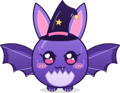

