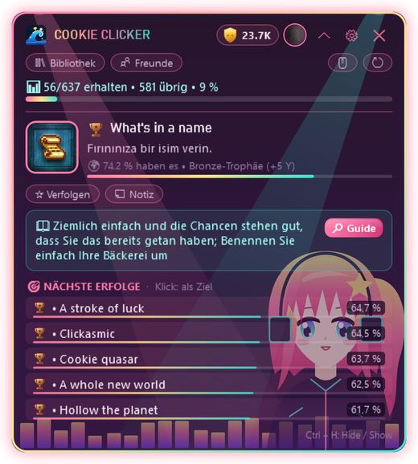

  

  
  
  
  

  <a href="README.md">English</a> · <a href="README.tr.md">Türkçe</a> · <a href="README.ru.md">Русский</a> · <a href="README.es.md">Español</a> · <a href="README.zh.md">中文</a> · <b>Deutsch</b> · <a href="README.fr.md">Français</a> · <a href="README.ja.md">日本語</a>

---

**HundoHunter** ist ein kleines Overlay, das beim Spielen in einer Bildschirmecke sitzt. Es erkennt dein laufendes Steam-Spiel und zeigt dir, **welchen Erfolg du als Nächstes holen solltest**, **wie du ihn bekommst** und **welche du für immer verpassen könntest**. Ein Ziel: jedes Spiel auf 100 % – ein *Hundo*.

Und du jagst nie allein. Darf ich vorstellen: die **Hundos** 💖

  

## 💖 Lerne die Hundos kennen

Die Hundos sind die kleinen Mädchen, die in den Themes von HundoHunter wohnen. Sie blinzeln, wiegen sich, wedeln mit dem Schwanz und **springen vor Freude, jedes Mal wenn du einen Erfolg freischaltest**. Jede hat ihre Lieblingsaufgabe:

<table>
<tr>
<td width="200" align="center"> <b>Neko</b></td>
<td>
<b>Die Spürnase.</b> Neko wittert deinen <b>nächsten Erfolg</b>, sobald ein Spiel startet – mit Beschreibung und Guide-Tipp. Ihre Ohren zucken, wenn etwas nah ist (z. B. Fortschrittserfolge wie <code>32/50</code>).
  <i>"Nyaa~ nur noch drei, dann gehört er dir!"</i>
</td>
</tr>
<tr>
<td width="200" align="center"> <b>Mondschein</b></td>
<td>
<b>Die stille Hüterin.</b> Mondschein wacht über deine <b>Bibliothek</b>, deinen <b>14-Tage-Verlauf</b> und die Spiele, die <b>am nächsten an 100 %</b> sind – so weißt du immer, welcher Hundo in Reichweite ist.
  <i>"Stardew Valley steht bei 86 %... machen wir es heute Abend fertig?"</i>
</td>
</tr>
<tr>
<td width="200" align="center"> <b>Neon-Rhythmus</b></td>
<td>
<b>Die Cheerleaderin.</b> Wenn ein Erfolg aufploppt, weiß sie es zuerst: <b>sofortige Erkennung</b>, in derselben Sekunde wie Steams eigene Benachrichtigung. Trophäen-Sound, Hinweis, ein Sprung – und dein <b>Y-Score</b> steigt.
  <i>"Diamant-Trophäe!! Weniger als 1 % der Spieler haben die!"</i>
</td>
</tr>
<tr>
<td width="200" align="center"> <b>Gothic-Prinzessin</b></td>
<td>
<b>Die Wächterin.</b> Sie warnt dich vor <b>verpassbaren Erfolgen</b>, bevor es zu spät ist (KI-gestützte Erkennung), und hält <b>versteckte Erfolge verschwommen</b>, damit nichts gespoilert wird.
  <i>"Vorsicht. Wenn du dieses Kapitel verlässt, ist die Trophäe für immer weg."</i>
</td>
</tr>
</table>

## ✨ Funktionen

<table>
<tr>
<td width="50%" valign="top"></td>
<td valign="top">
<h3> Guide im Spiel</h3>
<ul>
<li>Erkennt das laufende Steam-Spiel automatisch</li>
<li><b>Nächster Zielerfolg</b> mit Beschreibung, Seltenheit und Guide-Tipp</li>
<li><b>Nächstgelegene Erfolge</b> mit Seltenheitsbalken</li>
<li>Verfolge beliebige Erfolge als Ziel und füge Notizen hinzu</li>
<li>Funktioniert über Spielen im <b>randlosen Fenster / Fenster-Vollbild</b></li>
</ul>
<h3> Sofortige Freischaltungen</h3>
<ul>
<li>Liest Steams eigene lokale Daten: Erfolge erscheinen <b>in derselben Sekunde wie bei Steam</b></li>
<li>Funktioniert auch, wenn deine <i>Spieldetails</i> privat sind</li>
<li>Offline-Cache: funktioniert auch ohne Internet</li>
</ul>
</td>
</tr>
<tr>
<td valign="top">
<h3> Keine Überraschungen, keine Spoiler</h3>
<ul>
<li>Warnungen vor <b>verpassbaren Erfolgen</b> (KI-gestützt: Gemini oder OpenAI)</li>
<li>Guide-Texte werden <b>automatisch übersetzt</b></li>
<li><b>Spoiler-Schutz</b>: versteckte Erfolge bleiben verschwommen, bis du willst</li>
</ul>
<h3> Deine ganze Sammlung</h3>
<ul>
<li>Bibliothek mit dem Fortschritt jedes Spiels und den Spielen <b>am nächsten an 100 %</b></li>
<li>14-Tage-Diagramm deiner Freischaltungen</li>
<li><b>Freundesvergleich</b> und Freunde-Rangliste</li>
<li>Mehrere Steam-Konten, Wechsel mit einem Klick</li>
</ul>
</td>
<td valign="top"></td>
</tr>
</table>

  &nbsp;&nbsp;
  

## 🏆 Trophäenstufen & Y-Score

Jeder Erfolg bekommt eine Stufe, je nachdem wie viele Spieler ihn freigeschaltet haben – und jede Stufe hat ihren eigenen Sound.

| | Stufe | Freigeschaltet von | Punkte |
|:-:|---|---|--:|
|  | **Bronze** | 50 % und mehr | 5 |
|  | **Silber** | 20 % – 50 % | 15 |
|  | **Gold** | 5 % – 20 % | 40 |
|  | **Saphir** | 1 % – 5 % | 100 |
|  | **Diamant** | unter 1 % | 250 |

Schließe ein Spiel zu 100 % ab für einen **Bonus von +50**. Steig im Rang auf: Neuling → Bronze-Jäger → Silber-Jäger → Gold-Jäger → Saphir-Meister → Diamant-Meister → **Legende**.

## 🎨 20 Themes (und ein paar geheime)

Die meisten Themes sind animiert. Die Hundos wohnen in **Neko**, **Mondschein**, **Neon-Rhythmus** und **Gothic-Prinzessin**, und sie haben auch Maskottchen-Freunde. Du kannst sogar **dein eigenes Hintergrundbild** setzen – zusammen mit einem Theme oder allein.

  

> 🤫 Manche Themes stehen nicht in der Liste. Man munkelt, die Hundos flüstern die Passwörter nur echten Jägern zu...

## 📥 Download & Einrichtung

1. Lade **HundoHunter.zip** aus dem [neuesten Release](../../releases/latest) herunter und entpacke es irgendwo.
2. Starte `HundoHunter.exe`. Sonst musst du nichts installieren: es ist eine einzelne Datei mit .NET an Bord. *Windows zeigt eventuell „Der Computer wurde durch Windows geschützt“, weil die App nicht signiert ist. Klicke auf **Weitere Informationen → Trotzdem ausführen**.*
3. Hol dir einen kostenlosen **Steam-Web-API-Schlüssel** unter <https://steamcommunity.com/dev/apikey> (jeder Domainname geht, z. B. `localhost`) und füge ihn in den Einstellungen ein.
4. Füge dein Konto hinzu: Link zu deinem Steam-Profil, eigene URL oder 17-stellige Steam-ID.
5. *(Optional)* Füge einen **Google-Gemini**- (mit kostenlosem Kontingent) oder **OpenAI**-Schlüssel hinzu, für Verpassbar-Erkennung und Guide-Übersetzung.
6. Klicke auf **Speichern & Starten**, starte ein Spiel über Steam und sag deiner Hundo Hallo.

> 💡 Für Bibliothek, Verlauf und Freunde stelle **Steam → Profil bearbeiten → Privatsphäre → Spieldetails** auf **Öffentlich**.

### Tastenkürzel

| Tasten | Aktion |
|---|---|
| `Strg` + `H` | Overlay ein- / ausblenden |
| `Strg` + `Shift` + `H` | Durchklick-Modus (Klicks gehen ans Spiel) |
| `Strg` + `Alt` + `K` | Kompaktmodus |

Alle Kürzel lassen sich in den Einstellungen ändern.

## 🔒 Datenschutz

- API-Schlüssel werden nur für dein Windows-Konto verschlüsselt (Windows DPAPI).
- Steams lokale Statistikdateien werden nur **gelesen**, nie verändert.
- Dein Hintergrundbild bleibt auf deinem PC; nur sein Speicherort wird gemerkt.
- Keine Telemetrie. HundoHunter spricht nur mit Steam, dem gewählten KI-Dienst und dem Übersetzungsdienst.

## ❓ Fehlerbehebung

| Problem | Versuch das |
|---|---|
| Nicht über dem Spiel sichtbar | Stell das Spiel auf **randloses Fenster / Fenster-Vollbild**. Exklusiver Vollbildmodus kann keine anderen Fenster zeigen. |
| Erfolge können nicht gelesen werden | Stimmt dein API-Schlüssel? Sind die *Spieldetails* öffentlich? |
| Freischaltungen erscheinen verspätet | Läuft Steam und hast du das Spiel über Steam gestartet? |
| Falsches Spiel erkannt | Trage die AppID des Spiels (die Zahl im Store-Link) unter *Spiel manuell wählen* ein. |
| Overlay verschwunden | Drücke `Strg` + `H` oder klicke auf das Tray-Symbol. |

## 💝 HundoHunter unterstützen

HundoHunter ist kostenlos und mit Liebe gemacht. Wenn es dir zu einem Hundo verholfen hat, kannst du den Hundos eine Leckerei spendieren! Jede Unterstützung bringt neue Themes, Funktionen und Hundos.

  
  

## 📜 Rechtliches & Credits

HundoHunter ist ein unabhängiges Fanprojekt und **nicht mit der Valve Corporation oder Steam verbunden**. Steam und das Steam-Logo sind Marken der Valve Corporation. Spiel- und Erfolgsdaten stammen aus der Steam Web API.

Die Hundos und alle Theme-Grafiken sind originale Vektorzeichnungen für HundoHunter. Schriftart „Press Start 2P“ von CodeMan38, SIL Open Font License 1.1.

  Mit 💖 gemacht von <b>Wavemint</b> 
  

