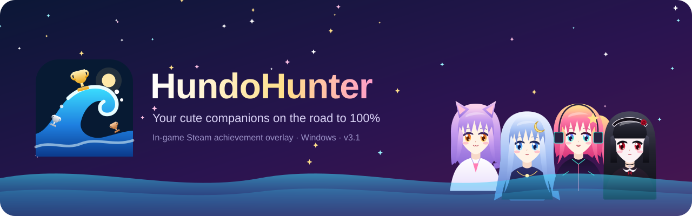
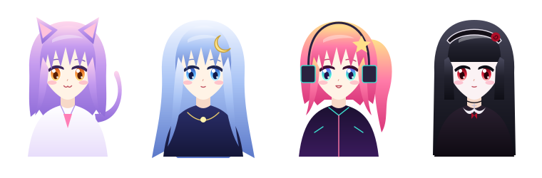
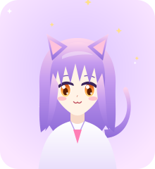
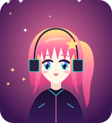
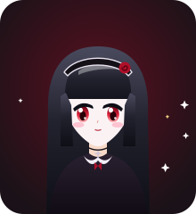
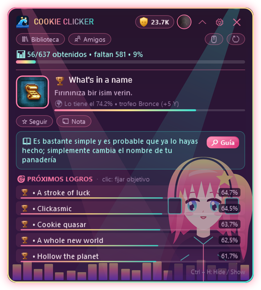
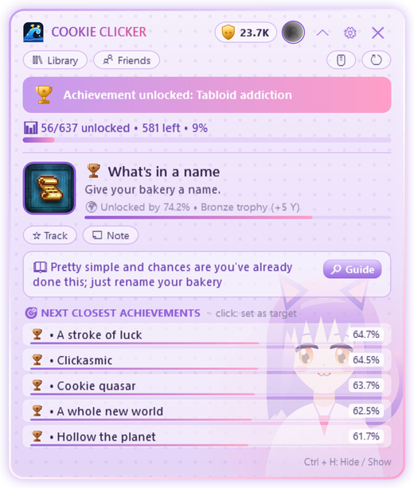
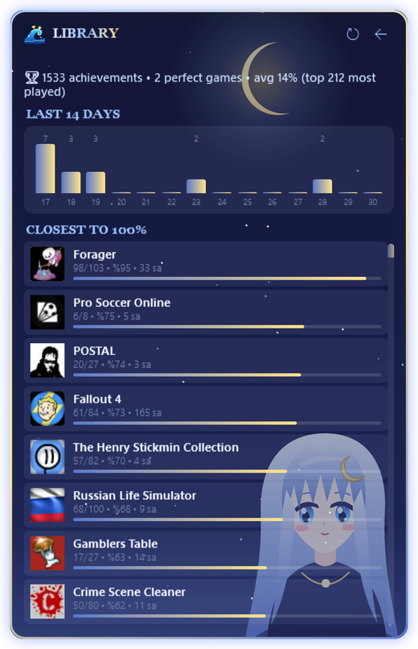
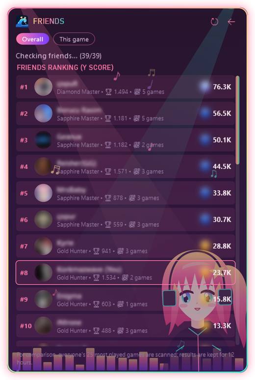
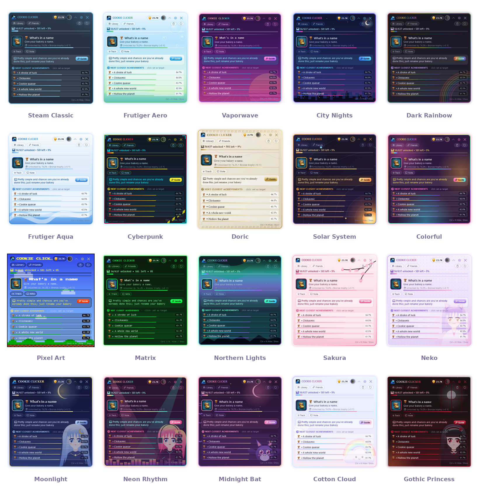

  

  
  
  
  

  <a href="README.md">English</a> · <a href="README.tr.md">Türkçe</a> · <a href="README.ru.md">Русский</a> · <b>Español</b> · <a href="README.zh.md">中文</a> · <a href="README.de.md">Deutsch</a> · <a href="README.fr.md">Français</a> · <a href="README.ja.md">日本語</a>

---

**HundoHunter** es una pequeña ventana superpuesta que se queda en una esquina de la pantalla mientras juegas. Reconoce el juego de Steam que tienes abierto y te dice **qué logro conseguir después**, **cómo conseguirlo** y **cuáles podrías perder para siempre**. Un solo objetivo: completar cada juego al 100%, un *hundo*.

Y nunca cazas solo. Te presentamos a las **Hundos** 💖

  

## 💖 Conoce a las Hundos

Las Hundos son las niñas que viven en los temas de HundoHunter. Parpadean, se balancean, mueven la cola y **saltan de alegría cada vez que desbloqueas un logro**. Cada una tiene su tarea favorita:

<table>
<tr>
<td width="200" align="center"> <b>Neko</b></td>
<td>
<b>La rastreadora.</b> Neko olfatea tu <b>próximo logro</b> en cuanto empieza el juego, con su descripción y una pista de la guía. Sus orejas se mueven cuando algo está cerca (por ejemplo, logros con progreso <code>32/50</code>).
  <i>"Nyaa~ ¡solo tres más y es tuyo!"</i>
</td>
</tr>
<tr>
<td width="200" align="center"> <b>Luz de Luna</b></td>
<td>
<b>La guardiana tranquila.</b> Luz de Luna cuida tu <b>biblioteca</b>, tu <b>historial de 14 días</b> y los juegos <b>más cerca del 100%</b>, para que siempre sepas qué hundo tienes al alcance.
  <i>"Stardew Valley está al 86%... ¿lo terminamos esta noche?"</i>
</td>
</tr>
<tr>
<td width="200" align="center"> <b>Ritmo Neón</b></td>
<td>
<b>La animadora.</b> Cuando salta un logro, ella es la primera en enterarse: <b>detección instantánea</b>, en el mismo segundo que la notificación de Steam. Sonido de trofeo, aviso, un salto y tu <b>puntuación Y</b> sube.
  <i>"¡¡Trofeo de diamante!! ¡Menos del 1% de los jugadores lo tiene!"</i>
</td>
</tr>
<tr>
<td width="200" align="center"> <b>Princesa Gótica</b></td>
<td>
<b>La protectora.</b> Te avisa de los <b>logros que se pueden perder</b> antes de que sea tarde (detección con IA) y mantiene <b>borrosos los logros ocultos</b> para que nada se destripe.
  <i>"Cuidado. Si sales de este capítulo, ese trofeo se pierde para siempre."</i>
</td>
</tr>
</table>

## ✨ Funciones

<table>
<tr>
<td width="50%" valign="top"></td>
<td valign="top">
<h3> Guía dentro del juego</h3>
<ul>
<li>Detecta automáticamente el juego de Steam en ejecución</li>
<li><b>Próximo logro objetivo</b> con descripción, rareza y pista de la guía</li>
<li><b>Logros más cercanos</b> con barras de rareza</li>
<li>Sigue cualquier logro como objetivo y añade tus notas</li>
<li>Funciona encima de juegos en <b>ventana sin bordes / pantalla completa en ventana</b></li>
</ul>
<h3> Desbloqueos al instante</h3>
<ul>
<li>Lee los registros locales del propio Steam: los logros aparecen <b>en el mismo segundo que en Steam</b></li>
<li>Funciona aunque tus <i>Detalles de juegos</i> sean privados</li>
<li>Caché sin conexión: funciona sin internet</li>
</ul>
</td>
</tr>
<tr>
<td valign="top">
<h3> Sin sorpresas ni spoilers</h3>
<ul>
<li>Avisos de <b>logros perdibles</b> (con IA: Gemini u OpenAI)</li>
<li>Textos de guía <b>traducidos automáticamente</b> a tu idioma</li>
<li><b>Protección contra spoilers</b>: los logros ocultos siguen borrosos hasta que tú quieras</li>
</ul>
<h3> Toda tu colección</h3>
<ul>
<li>Biblioteca con el progreso de cada juego y los <b>más cercanos al 100%</b></li>
<li>Gráfico de desbloqueos de 14 días</li>
<li><b>Comparación con amigos</b> y clasificación de amigos</li>
<li>Varias cuentas de Steam, cambia con un clic</li>
</ul>
</td>
<td valign="top"></td>
</tr>
</table>

  &nbsp;&nbsp;
  

## 🏆 Niveles de trofeo y puntuación Y

Cada logro recibe un nivel según cuántos jugadores lo han desbloqueado, y cada nivel tiene su propio sonido.

| | Nivel | Desbloqueado por | Puntos |
|:-:|---|---|--:|
|  | **Bronce** | 50% o más | 5 |
|  | **Plata** | 20% – 50% | 15 |
|  | **Oro** | 5% – 20% | 40 |
|  | **Zafiro** | 1% – 5% | 100 |
|  | **Diamante** | menos del 1% | 250 |

Termina un juego al 100% para un **bonus de +50**. Sube de rango: Novato → Cazador de bronce → Cazador de plata → Cazador de oro → Maestro zafiro → Maestro diamante → **Leyenda**.

## 🎨 20 temas (y algunos secretos)

La mayoría de los temas están animados. Las Hundos viven en **Neko**, **Luz de Luna**, **Ritmo Neón** y **Princesa Gótica**, y también tienen amigos mascota. Incluso puedes poner **tu propia imagen de fondo**, junto con un tema o sola.

  

> 🤫 Algunos temas no aparecen en la lista. Dicen que las Hundos solo susurran las contraseñas a los verdaderos cazadores...

## 📥 Descarga e instalación

1. Descarga **HundoHunter.zip** desde la [última versión](../../releases/latest) y descomprímelo donde quieras.
2. Ejecuta `HundoHunter.exe`. No hace falta instalar nada más: es un solo archivo con .NET incluido. *Windows puede decir "Windows protegió su PC" porque la app no está firmada. Haz clic en **Más información → Ejecutar de todas formas**.*
3. Consigue una **clave de Steam Web API** gratuita en <https://steamcommunity.com/dev/apikey> (sirve cualquier dominio, p. ej. `localhost`) y pégala en los ajustes.
4. Añade tu cuenta: pega el enlace de tu perfil de Steam, tu URL personalizada o tu Steam ID de 17 dígitos.
5. *(Opcional)* Añade una clave de **Google Gemini** (tiene nivel gratuito) u **OpenAI** para detectar logros perdibles y traducir guías.
6. Pulsa **Guardar e iniciar**, abre un juego desde Steam y saluda a tu Hundo.

> 💡 Para la biblioteca, el historial y los amigos, pon **Steam → Editar perfil → Privacidad → Detalles de juegos** en **Público**.

### Atajos de teclado

| Teclas | Acción |
|---|---|
| `Ctrl` + `H` | Mostrar / ocultar la ventana |
| `Ctrl` + `Shift` + `H` | Modo clic a través (los clics van al juego) |
| `Ctrl` + `Alt` + `K` | Modo compacto |

Todos los atajos se pueden cambiar en los ajustes.

## 🔒 Privacidad

- Las claves API se cifran solo para tu cuenta de Windows (Windows DPAPI).
- Los archivos locales de estadísticas de Steam solo se **leen**, nunca se modifican.
- Tu imagen de fondo se queda en tu ordenador; solo se guarda su ubicación.
- Sin telemetría. HundoHunter solo habla con Steam, el servicio de IA que elijas y el servicio de traducción.

## ❓ Solución de problemas

| Problema | Prueba esto |
|---|---|
| No se ve encima del juego | Pon el juego en **ventana sin bordes / pantalla completa en ventana**. La pantalla completa exclusiva no puede mostrar otras ventanas. |
| No se pueden leer los logros | ¿Es correcta tu clave API? ¿Son públicos los *Detalles de juegos*? |
| Los logros aparecen tarde | ¿Steam está abierto y has iniciado el juego desde Steam? |
| Se detecta otro juego | Escribe el AppID del juego (el número de su enlace en la tienda) en *Elegir juego manualmente*. |
| La ventana desapareció | Pulsa `Ctrl` + `H` o haz clic en el icono de la bandeja. |

## 💝 Apoya HundoHunter

HundoHunter es gratis y está hecho con cariño. Si te ayudó a completar un hundo, ¡puedes invitar a las Hundos a un dulce! Cada aporte trae nuevos temas, funciones y Hundos.

  
  

## 📜 Aviso legal y créditos

HundoHunter es un proyecto de fans independiente y **no está afiliado a Valve Corporation ni a Steam**. Steam y el logotipo de Steam son marcas comerciales de Valve Corporation. Los datos de juegos y logros vienen de la Steam Web API.

Las Hundos y todo el arte de los temas son dibujos vectoriales originales hechos para HundoHunter. Fuente "Press Start 2P" de CodeMan38, SIL Open Font License 1.1.

  Hecho con 💖 por <b>Wavemint</b> 
  

