

  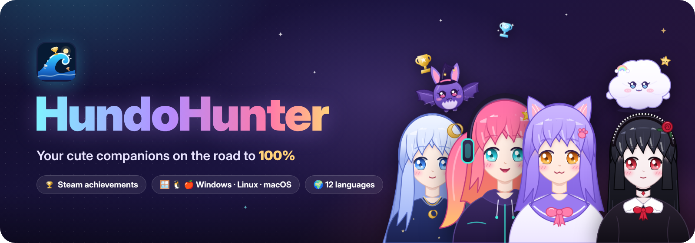

  
  
  
  
  

  <a href="README.md">English</a> · <a href="README.tr.md">Türkçe</a> · <a href="README.ru.md">Русский</a> · <a href="README.es.md">Español</a> · <a href="README.zh.md">中文</a> · <a href="README.de.md">Deutsch</a> · <b>Français</b> · <a href="README.ja.md">日本語</a>

---

  

**HundoHunter** est une petite fenêtre en surimpression qui reste dans un coin de l'écran pendant que tu joues. Elle reconnaît le jeu Steam lancé et te dit **quel succès viser ensuite**, **comment l'obtenir** et **lesquels tu pourrais rater pour toujours**. Un seul but : finir chaque jeu à 100 %, un *hundo*.

Et tu ne chasses jamais seul. Voici les **Hundos** 💖

  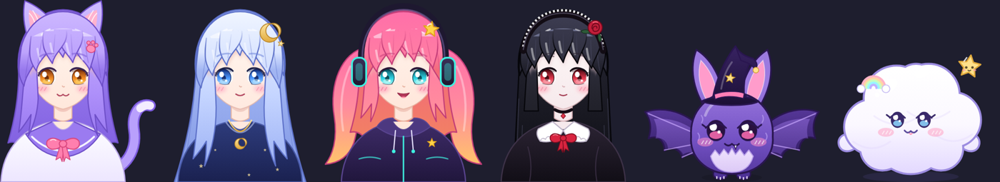

## 🆕 Nouveautés de la v4.2

<h3>🎁 Ton année, ton rang</h3>

<table>
<tr>
<td width="44%" valign="top">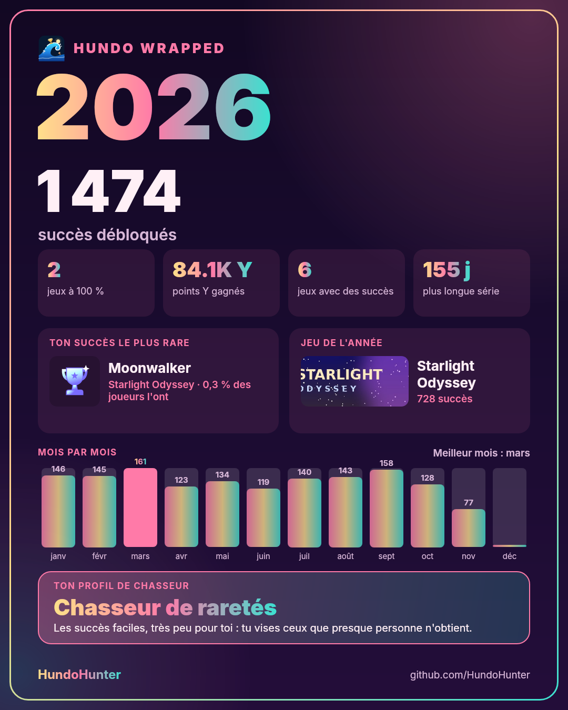</td>
<td valign="top">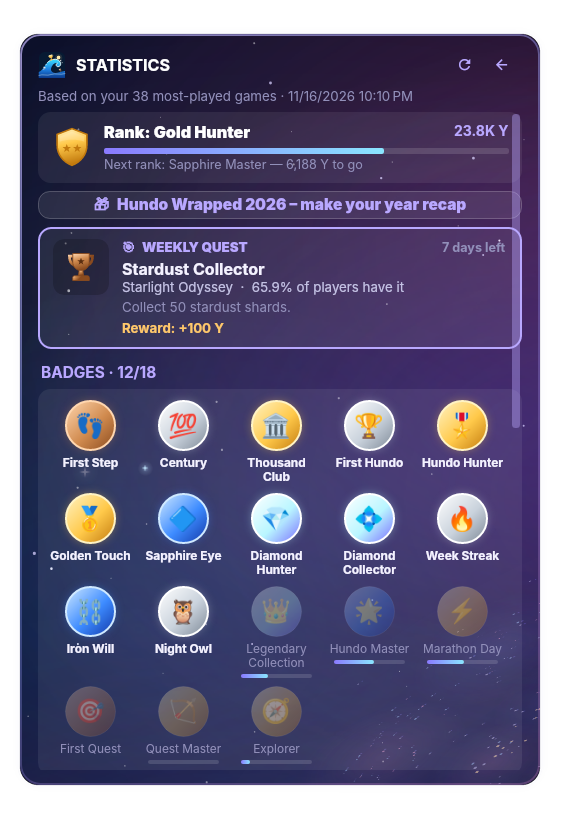
<ul>
<li><b>Hundo Wrapped</b> : un bilan de l'année (1080×1350) avec tes succès, tes 100 %, ton succès le plus rare, ton jeu de l'année, un graphique par mois et ton profil de chasseur.</li>
<li><b>Badges et progression de rang</b> : 18 badges avec barres de progression, et ce qu'il te reste avant le rang suivant.</li>
<li><b>Quête de la semaine</b> : un succès rare mais faisable dans un de tes jeux, +100 Y si tu le débloques dans la semaine.</li>
<li><b>Alertes « presque ! »</b> pour les succès à progression et une <b>estimation du temps jusqu'à 100 %</b> selon ton rythme.</li>
</ul>
</td>
</tr>
</table>

<h3>📺 Mode streamer et second écran</h3>

  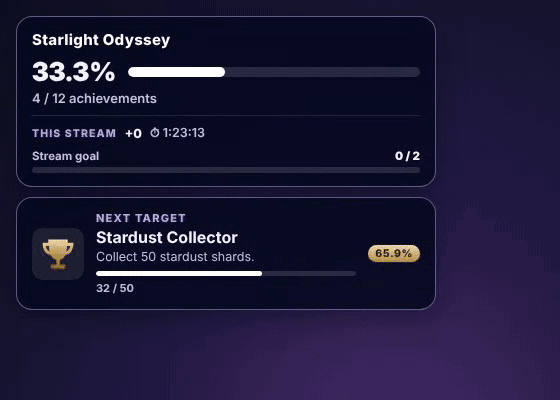

<table>
<tr>
<td width="66%" valign="top">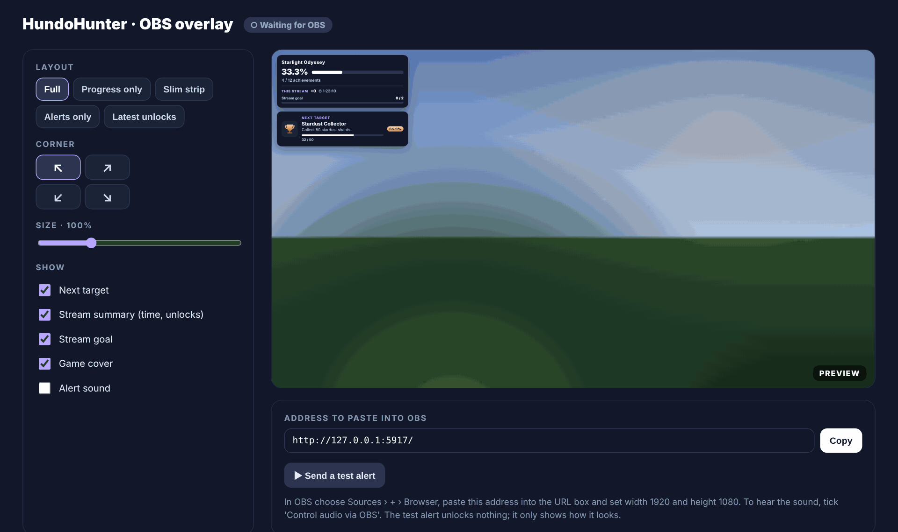
<ul>
<li><b>Mode streamer amélioré</b> : nouvel overlay OBS avec page de réglage et d'aperçu, objectif du live, alertes aux couleurs du trophée avec confettis, alerte de test et <b>commandes du chat Twitch</b> (<code>!target</code>, <code>!progress</code>, <code>!rarest</code>).</li>
<li><b>Publications dans un salon Discord</b> via webhook : succès rares, tous ou seulement les 100 %, avec ta carte.</li>
</ul>
</td>
<td valign="top">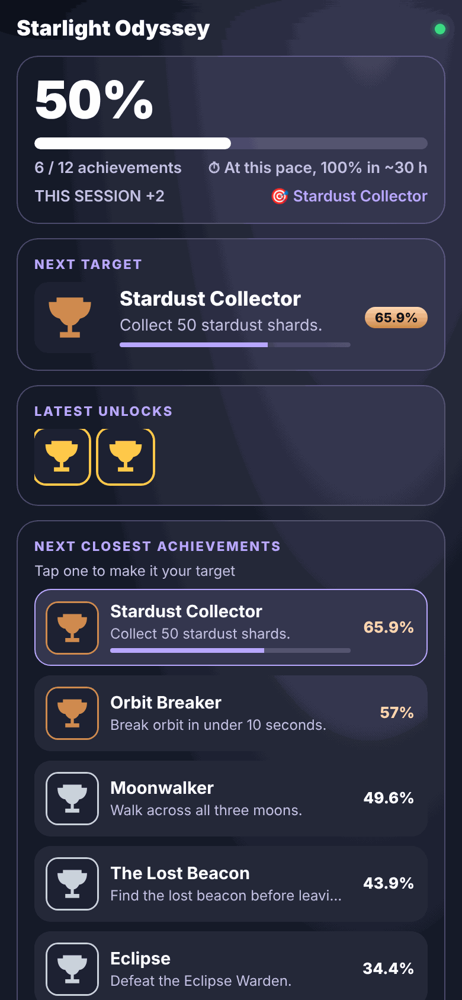
<ul>
<li><b>Le téléphone en second écran</b> : scanne un QR code et ton téléphone affiche le HUD ; touche un succès pour le viser. Uniquement sur ton réseau, avec une clé secrète.</li>
</ul>
</td>
</tr>
</table>

<h3>✨ Et aussi</h3>

<ul>
<li><b>Trois nouveaux thèmes pixel art</b> avec des animations dessinées à la main qui racontent une petite histoire : Braises et acier, Étang de lune et Vagabond des étoiles.</li>
<li>Une toute nouvelle <b>animation d'ouverture</b> : une vague translucide apporte les trophées et écrit le nom. Les animations tournent à <b>60 fps</b>, avec une fine barre de défilement aux couleurs du thème.</li>
<li><b>Mise à jour en un clic</b> depuis les paramètres et animations plus fluides dans tous les thèmes.</li>
</ul>

## 🕹️ Trois nouveaux thèmes pixel

Du pixel art dessiné à la main, chacun avec une petite histoire qui se répète toutes les quelques secondes.

<table>
<tr>
<td width="33%" align="center" valign="top">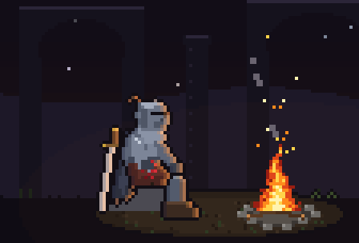 <b>Braises et acier</b> Un chevalier blessé se repose près d'un feu de camp où brûle une épée.</td>
<td width="33%" align="center" valign="top">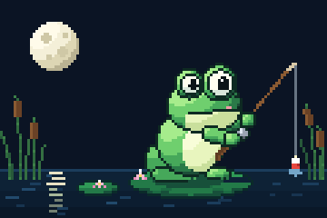 <b>Étang de lune</b> Une grenouille au bord d'un étang sous la lune, des lucioles et des poissons qui sautent.</td>
<td width="33%" align="center" valign="top">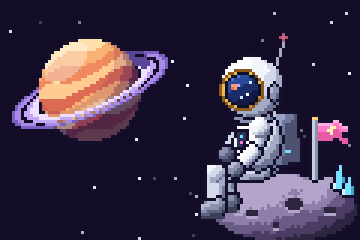 <b>Vagabond des étoiles</b> Un petit astronaute plante son drapeau sur un rocher à la dérive.</td>
</tr>
</table>

## 💖 Fais connaissance avec les Hundos

Les Hundos sont les petites filles qui vivent dans les thèmes de HundoHunter. Elles clignent des yeux, se balancent, remuent la queue et **sautent de joie à chaque succès débloqué**. Chacune a sa mission préférée :

<table>
<tr>
<td width="200" align="center">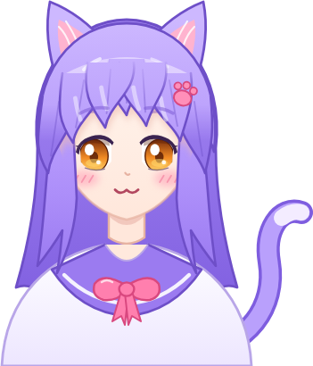 <b>Neko</b></td>
<td>
<b>La pisteuse.</b> Neko flaire ton <b>prochain succès</b> dès le lancement du jeu, avec sa description et un conseil de guide. Ses oreilles frémissent quand le but est proche (par ex. les succès à progression <code>32/50</code>).
  <i>"Nyaa~ plus que trois et il est à toi !"</i>
</td>
</tr>
<tr>
<td width="200" align="center">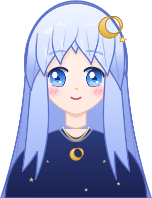 <b>Clair de Lune</b></td>
<td>
<b>La gardienne discrète.</b> Clair de Lune veille sur ta <b>bibliothèque</b>, ton <b>historique sur 14 jours</b> et les jeux <b>les plus proches du 100 %</b>, pour que tu saches toujours quel hundo est à portée.
  <i>"Stardew Valley est à 86 %... on le termine ce soir ?"</i>
</td>
</tr>
<tr>
<td width="200" align="center">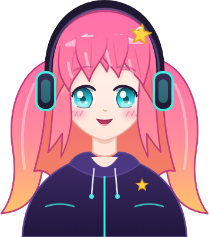 <b>Rythme Néon</b></td>
<td>
<b>La pom-pom girl.</b> Quand un succès tombe, elle le sait la première : <b>détection instantanée</b>, à la même seconde que la notification de Steam. Son de trophée, notification, un saut, et ton <b>score Y</b> grimpe.
  <i>"Trophée diamant !! Moins de 1 % des joueurs l'ont !"</i>
</td>
</tr>
<tr>
<td width="200" align="center">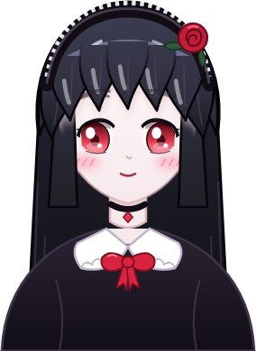 <b>Princesse Gothique</b></td>
<td>
<b>La gardienne.</b> Elle te prévient des <b>succès ratables</b> avant qu'il ne soit trop tard (détection assistée par IA) et garde les <b>succès cachés floutés</b> pour ne rien divulgâcher.
  <i>"Attention. Si tu quittes ce chapitre, ce trophée est perdu à jamais."</i>
</td>
</tr>
</table>

Et leurs deux petites mascottes :

<table>
<tr>
<td width="200" align="center">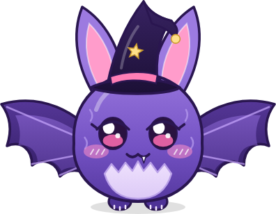 <b>Chauve-souris de minuit</b></td>
<td>
<b>La noctambule.</b> Elle tient compagnie à l'<b>overlay de stream</b> : barre d'objectif, badge LIVE et alertes à confettis pour tes viewers.
  <i>"Le chat, vous avez vu ? Trophée saphir !"</i>
</td>
</tr>
<tr>
<td width="200" align="center">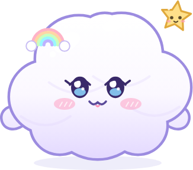 <b>Nuage de coton</b></td>
<td>
<b>La rêveuse.</b> Nuage de coton flotte au-dessus de tes <b>statistiques</b> : badges, quête hebdo et ton <b>Hundo Wrapped</b> en fin d'année.
  <i>"Plus que 4 badges... on va y arriver~"</i>
</td>
</tr>
</table>

## ✨ Fonctionnalités

<table>
<tr>
<td width="50%" valign="top">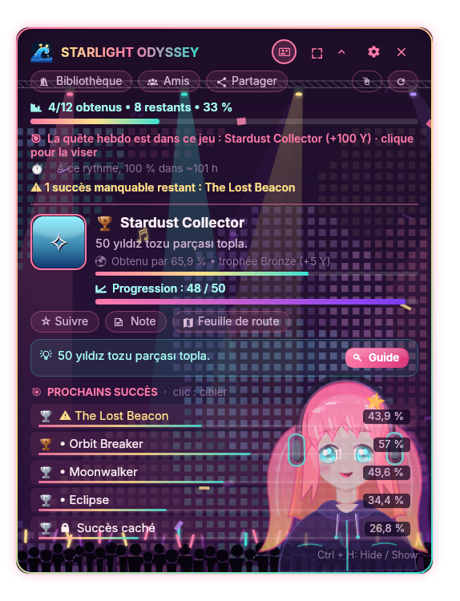</td>
<td valign="top">
<h3>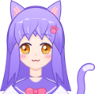 Guide en jeu</h3>
<ul>
<li>Détecte automatiquement le jeu Steam en cours</li>
<li><b>Prochain succès visé</b> avec description, rareté et conseil de guide</li>
<li><b>Succès les plus proches</b> avec barres de rareté</li>
<li>Suis n'importe quel succès comme objectif et ajoute tes notes</li>
<li>Fonctionne par-dessus les jeux en <b>fenêtré sans bordure / plein écran fenêtré</b></li>
</ul>
<h3>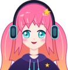 Déblocages instantanés</h3>
<ul>
<li>Lit les données locales de Steam : les succès apparaissent <b>à la même seconde que dans Steam</b></li>
<li>Fonctionne même si tes <i>Détails des jeux</i> sont privés</li>
<li>Cache hors ligne : fonctionne sans internet</li>
</ul>
</td>
</tr>
<tr>
<td valign="top">
<h3>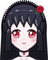 Pas de surprise, pas de spoiler</h3>
<ul>
<li>Alertes de <b>succès ratables</b> (assistées par IA : Gemini ou OpenAI)</li>
<li>Textes de guide <b>traduits automatiquement</b> dans ta langue</li>
<li><b>Protection anti-spoiler</b> : les succès cachés restent floutés jusqu'à ce que tu le veuilles</li>
</ul>
<h3>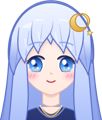 Toute ta collection</h3>
<ul>
<li>Bibliothèque avec la progression de chaque jeu et les <b>plus proches du 100 %</b></li>
<li>Graphique des déblocages sur 14 jours</li>
<li><b>Comparaison avec les amis</b> et classement des amis</li>
<li>Plusieurs comptes Steam, changement en un clic</li>
</ul>
</td>
<td valign="top">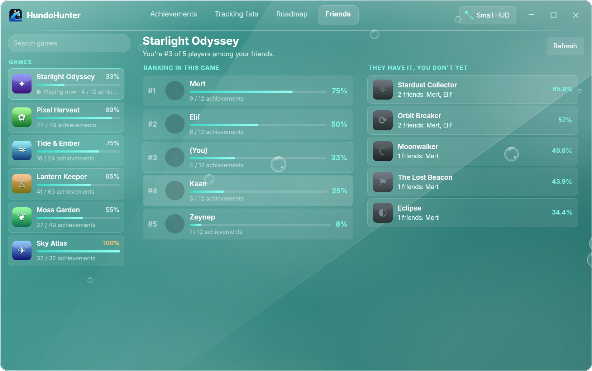</td>
</tr>
</table>

  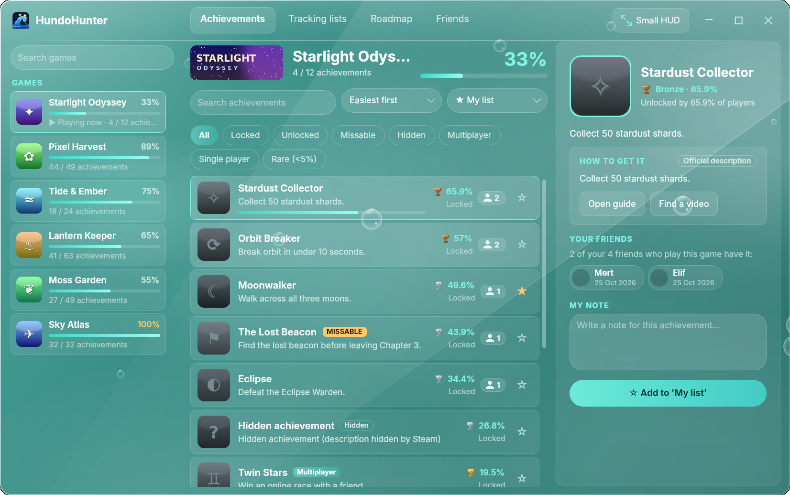

## 🏆 Niveaux de trophée et score Y

Chaque succès reçoit un niveau selon la proportion de joueurs qui l'ont débloqué, et chaque niveau a son propre son.

| | Niveau | Débloqué par | Points |
|:-:|---|---|--:|
|  | **Bronze** | 50 % et plus | 5 |
|  | **Argent** | 20 % – 50 % | 15 |
|  | **Or** | 5 % – 20 % | 40 |
|  | **Saphir** | 1 % – 5 % | 100 |
|  | **Diamant** | moins de 1 % | 250 |

Termine un jeu à 100 % pour un **bonus de +50**. Grimpe les rangs : Débutant → Chasseur de bronze → Chasseur d'argent → Chasseur d'or → Maître saphir → Maître diamant → **Légende**.

## 🎨 35 thèmes (et quelques secrets)

La plupart des thèmes sont animés. Les Hundos vivent dans **Neko**, **Clair de Lune**, **Rythme Néon** et **Princesse Gothique**, et elles ont aussi des amis mascottes. Tu peux même mettre **ta propre image de fond**, avec un thème ou toute seule.

  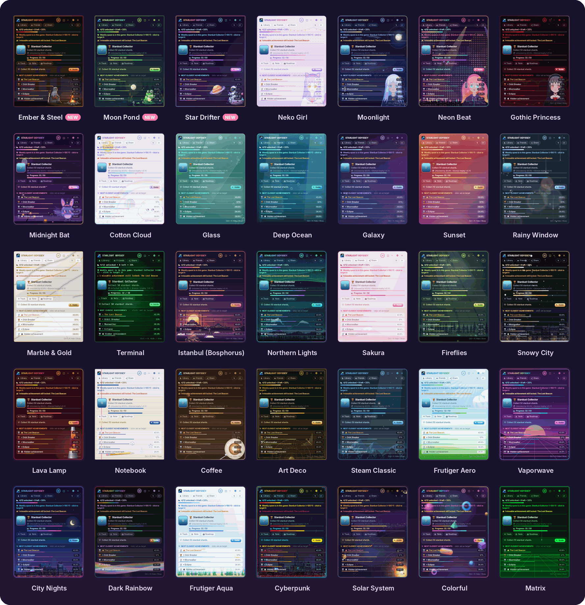

> 🤫 Certains thèmes n'apparaissent pas dans la liste. On raconte que les Hundos ne soufflent les mots de passe qu'aux vrais chasseurs...

## 📥 Téléchargement et installation

1. 🪟 **Windows:** Télécharge **HundoHunter.zip** depuis la [dernière version](../../releases/latest) et décompresse-le où tu veux.
2. Lance `HundoHunter.exe`. Rien d'autre à installer : c'est un seul fichier avec .NET inclus. *Windows peut afficher « Windows a protégé votre ordinateur » car l'appli n'est pas signée. Clique sur **Informations complémentaires → Exécuter quand même**.*
   - 🐧 **Linux :** télécharge `HundoHunter-4.2.0-linux-x64.tar.gz`, décompresse-le et lance `./install.sh` (ajoute HundoHunter au menu des applications). Fonctionne au mieux dans une session X11 ; sous Wayland, les raccourcis et le mode toujours au premier plan dépendent de ton bureau.
   - 🍎 **macOS :** télécharge le zip pour ton Mac (`AppleSilicon` pour M1–M4, `Intel` pour les Mac plus anciens), décompresse-le et déplace `HundoHunter.app` dans Applications. L'appli n'est pas signée : la première fois, fais un clic droit et choisis **Ouvrir**.
   - 🎮 **Steam Deck :** utilise la version Linux. En mode Jeu, le petit HUD s'affiche par-dessus le jeu et se montre ou se cache à la manette. La grande fenêtre n'est pas disponible sur Steam Deck.
3. Obtiens une **clé Steam Web API** gratuite sur <https://steamcommunity.com/dev/apikey> (n'importe quel nom de domaine, par ex. `localhost`) et colle-la dans les paramètres.
4. Ajoute ton compte : colle le lien de ton profil Steam, ton URL personnalisée ou ton Steam ID à 17 chiffres.
5. *(Facultatif)* Ajoute une clé **Google Gemini** (offre gratuite) ou **OpenAI** pour la détection des succès ratables et la traduction des guides.
6. Clique sur **Enregistrer et lancer**, démarre un jeu depuis Steam et dis bonjour à ta Hundo.

> 💡 Pour la bibliothèque, l'historique et les amis, règle **Steam → Modifier le profil → Confidentialité → Détails des jeux** sur **Public**.

### Raccourcis

| Touches | Action |
|---|---|
| `Ctrl` + `H` | Afficher / masquer la fenêtre |
| `Ctrl` + `Shift` + `H` | Mode clic traversant (les clics vont au jeu) |
| `Ctrl` + `Shift` + `A` | Ouvrir la grande fenêtre |
| `Ctrl` + `1` … `4` | Changer d'onglet dans la grande fenêtre |

Tous les raccourcis se modifient dans les paramètres. Le mode compact et l'actualisation n'ont pas de touche par défaut. Tu peux aussi afficher ou masquer la fenêtre avec une manette.

## 🔒 Confidentialité

- Les clés API sont chiffrées pour ton seul compte (Windows DPAPI sous Windows ; sous Linux et macOS, un fichier de clé privé que toi seul peux lire).
- Les fichiers de statistiques locaux de Steam sont seulement **lus**, jamais modifiés.
- Ton image de fond reste sur ton ordinateur ; seul son emplacement est enregistré.
- Aucune télémétrie. HundoHunter ne parle qu'à Steam, au service d'IA que tu choisis, au service de traduction et à GitHub (pour vérifier les mises à jour).
- La page d'overlay pour le stream ne s'ouvre que depuis ton propre ordinateur (127.0.0.1).
- Les captures et cartes de partage sont enregistrées dans ton dossier Images ; rien n'est envoyé en ligne.
- Le statut Discord est facultatif et passe uniquement par l'application Discord de ton ordinateur.
- Le signalement de bug ouvre un ticket GitHub que tu peux relire avant l'envoi. Les clés API, les identifiants Steam, les adresses e-mail et ton nom d'utilisateur sont masqués.
- La page téléphone ne fonctionne que sur ton propre réseau et demande la clé secrète du QR code.
- L'adresse du webhook Discord est enregistrée chiffrée, comme tes clés API.
- Le chat Twitch est lu anonymement, en lecture seule ; HundoHunter n'écrit jamais dans ton chat.

## ❓ Dépannage

| Problème | Essaie ceci |
|---|---|
| Invisible par-dessus le jeu | Passe le jeu en **fenêtré sans bordure / plein écran fenêtré**. Le plein écran exclusif ne peut pas afficher d'autres fenêtres. |
| Impossible de lire les succès | Ta clé API est-elle correcte ? Tes *Détails des jeux* sont-ils publics ? |
| Les succès apparaissent en retard | Steam est-il lancé, et as-tu démarré le jeu via Steam ? |
| Mauvais jeu détecté | Saisis l'AppID du jeu (le nombre dans son lien de boutique) dans *Choisir le jeu manuellement*. |
| La fenêtre a disparu | Appuie sur `Ctrl` + `H` ou clique sur l'icône de la barre des tâches. |
| La page téléphone ne s'ouvre pas | Le téléphone doit être sur le même Wi-Fi ; autorise HundoHunter dans le pare-feu (réseaux privés). |
| Les posts Discord n'apparaissent pas | Utilise <b>Envoyer un test</b> dans les paramètres ; vérifie que l'URL du webhook est complète et que le salon existe. |

## 💝 Soutenir HundoHunter

HundoHunter est gratuit et fait avec amour. S'il t'a aidé à décrocher un hundo, tu peux offrir une gourmandise aux Hundos ! Chaque soutien fait venir de nouveaux thèmes, fonctionnalités et Hundos.

  
  

<b>Avant : ce qui est arrivé en v4.1</b>

- **La grande fenêtre** (`Ctrl` + `Shift` + `A`) : tous tes jeux et succès côte à côte, avec filtres, tri, guides, notes et amis. La recherche trouve chaque jeu que tu possèdes, même ceux jamais lancés, et pardonne les fautes de frappe.
- **Listes de suivi** : regroupe les succès de n'importe quel jeu dans des listes nommées. Le petit HUD affiche la liste que tu choisis.
- **Feuille de route 100 %** : l'IA découpe les succès d'un jeu en étapes logiques, les ratables d'abord et le farm à la fin.
- **Onglet Amis** : un classement par jeu, « ils l'ont, pas toi », qui a débloqué quoi et quand, et une alerte quand un ami te dépasse.
- **Statistiques et résumé de session** : totaux, série et graphique mensuel, plus une petite carte après chaque session de jeu.
- **Carte de partage** : une image de progression 1200×630 aux couleurs de ton thème, avec la capture prise au moment du déblocage.
- **Mode streamer** : une page d'overlay transparente pour OBS / Streamlabs (source Navigateur).
- **Statut Discord**, **affichage à la manette** (Xbox, PlayStation, Steam Deck ; Windows et Linux) et prise en charge du **mode Jeu du Steam Deck**.
- **Descriptions des succès cachés** tirées des données de Steam, toujours floutées jusqu'à ce que tu demandes.
- **Mise à jour en un clic**, vérifiée par SHA256, et un bouton **Signaler un bug** qui masque tes clés et identifiants.
- **4 nouvelles langues** : Português (BR), Polski, 한국어 et Italiano (12 au total).
- **32 thèmes**, dont 8 nouveaux : Verre, Océan profond, Galaxie, Coucher de soleil, Vitre de pluie, Marbre et or, Terminal, Istanbul (Bosphore). Tous les thèmes ont été redessinés et les animations sont plus fluides et plus légères.

## 📜 Mentions légales et crédits

HundoHunter est un projet de fan indépendant et **n'est pas affilié à Valve Corporation ni à Steam**. Steam et le logo Steam sont des marques de Valve Corporation. Les données de jeux et de succès proviennent de la Steam Web API.

Les Hundos et toutes les illustrations des thèmes sont des dessins vectoriels originaux créés pour HundoHunter. Police « Press Start 2P » par CodeMan38, SIL Open Font License 1.1. Police « Mr Dafoe » d'Alejandro Paul (Sudtipos), SIL Open Font License 1.1. Icônes de Material Design Icons par Pictogrammers, Apache License 2.0. Les trois thèmes pixel sont du pixel art original dessiné pour HundoHunter.

  Fait avec 💖 par <b>Wavemint</b> 
  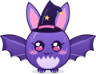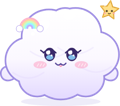

