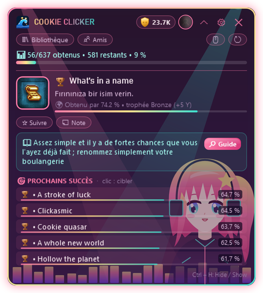

  

  
  
  
  

  <a href="README.md">English</a> · <a href="README.tr.md">Türkçe</a> · <a href="README.ru.md">Русский</a> · <a href="README.es.md">Español</a> · <a href="README.zh.md">中文</a> · <a href="README.de.md">Deutsch</a> · <b>Français</b> · <a href="README.ja.md">日本語</a>

---

**HundoHunter** est une petite fenêtre en surimpression qui reste dans un coin de l'écran pendant que tu joues. Elle reconnaît le jeu Steam lancé et te dit **quel succès viser ensuite**, **comment l'obtenir** et **lesquels tu pourrais rater pour toujours**. Un seul but : finir chaque jeu à 100 %, un *hundo*.

Et tu ne chasses jamais seul. Voici les **Hundos** 💖

  

## 💖 Fais connaissance avec les Hundos

Les Hundos sont les petites filles qui vivent dans les thèmes de HundoHunter. Elles clignent des yeux, se balancent, remuent la queue et **sautent de joie à chaque succès débloqué**. Chacune a sa mission préférée :

<table>
<tr>
<td width="200" align="center"> <b>Neko</b></td>
<td>
<b>La pisteuse.</b> Neko flaire ton <b>prochain succès</b> dès le lancement du jeu, avec sa description et un conseil de guide. Ses oreilles frémissent quand le but est proche (par ex. les succès à progression <code>32/50</code>).
  <i>"Nyaa~ plus que trois et il est à toi !"</i>
</td>
</tr>
<tr>
<td width="200" align="center"> <b>Clair de Lune</b></td>
<td>
<b>La gardienne discrète.</b> Clair de Lune veille sur ta <b>bibliothèque</b>, ton <b>historique sur 14 jours</b> et les jeux <b>les plus proches du 100 %</b>, pour que tu saches toujours quel hundo est à portée.
  <i>"Stardew Valley est à 86 %... on le termine ce soir ?"</i>
</td>
</tr>
<tr>
<td width="200" align="center"> <b>Rythme Néon</b></td>
<td>
<b>La pom-pom girl.</b> Quand un succès tombe, elle le sait la première : <b>détection instantanée</b>, à la même seconde que la notification de Steam. Son de trophée, notification, un saut, et ton <b>score Y</b> grimpe.
  <i>"Trophée diamant !! Moins de 1 % des joueurs l'ont !"</i>
</td>
</tr>
<tr>
<td width="200" align="center"> <b>Princesse Gothique</b></td>
<td>
<b>La gardienne.</b> Elle te prévient des <b>succès ratables</b> avant qu'il ne soit trop tard (détection assistée par IA) et garde les <b>succès cachés floutés</b> pour ne rien divulgâcher.
  <i>"Attention. Si tu quittes ce chapitre, ce trophée est perdu à jamais."</i>
</td>
</tr>
</table>

## ✨ Fonctionnalités

<table>
<tr>
<td width="50%" valign="top"></td>
<td valign="top">
<h3> Guide en jeu</h3>
<ul>
<li>Détecte automatiquement le jeu Steam en cours</li>
<li><b>Prochain succès visé</b> avec description, rareté et conseil de guide</li>
<li><b>Succès les plus proches</b> avec barres de rareté</li>
<li>Suis n'importe quel succès comme objectif et ajoute tes notes</li>
<li>Fonctionne par-dessus les jeux en <b>fenêtré sans bordure / plein écran fenêtré</b></li>
</ul>
<h3> Déblocages instantanés</h3>
<ul>
<li>Lit les données locales de Steam : les succès apparaissent <b>à la même seconde que dans Steam</b></li>
<li>Fonctionne même si tes <i>Détails des jeux</i> sont privés</li>
<li>Cache hors ligne : fonctionne sans internet</li>
</ul>
</td>
</tr>
<tr>
<td valign="top">
<h3> Pas de surprise, pas de spoiler</h3>
<ul>
<li>Alertes de <b>succès ratables</b> (assistées par IA : Gemini ou OpenAI)</li>
<li>Textes de guide <b>traduits automatiquement</b> dans ta langue</li>
<li><b>Protection anti-spoiler</b> : les succès cachés restent floutés jusqu'à ce que tu le veuilles</li>
</ul>
<h3> Toute ta collection</h3>
<ul>
<li>Bibliothèque avec la progression de chaque jeu et les <b>plus proches du 100 %</b></li>
<li>Graphique des déblocages sur 14 jours</li>
<li><b>Comparaison avec les amis</b> et classement des amis</li>
<li>Plusieurs comptes Steam, changement en un clic</li>
</ul>
</td>
<td valign="top"></td>
</tr>
</table>

  &nbsp;&nbsp;
  

## 🏆 Niveaux de trophée et score Y

Chaque succès reçoit un niveau selon la proportion de joueurs qui l'ont débloqué, et chaque niveau a son propre son.

| | Niveau | Débloqué par | Points |
|:-:|---|---|--:|
|  | **Bronze** | 50 % et plus | 5 |
|  | **Argent** | 20 % – 50 % | 15 |
|  | **Or** | 5 % – 20 % | 40 |
|  | **Saphir** | 1 % – 5 % | 100 |
|  | **Diamant** | moins de 1 % | 250 |

Termine un jeu à 100 % pour un **bonus de +50**. Grimpe les rangs : Débutant → Chasseur de bronze → Chasseur d'argent → Chasseur d'or → Maître saphir → Maître diamant → **Légende**.

## 🎨 20 thèmes (et quelques secrets)

La plupart des thèmes sont animés. Les Hundos vivent dans **Neko**, **Clair de Lune**, **Rythme Néon** et **Princesse Gothique**, et elles ont aussi des amis mascottes. Tu peux même mettre **ta propre image de fond**, avec un thème ou toute seule.

  

> 🤫 Certains thèmes n'apparaissent pas dans la liste. On raconte que les Hundos ne soufflent les mots de passe qu'aux vrais chasseurs...

## 📥 Téléchargement et installation

1. Télécharge **HundoHunter.zip** depuis la [dernière version](../../releases/latest) et décompresse-le où tu veux.
2. Lance `HundoHunter.exe`. Rien d'autre à installer : c'est un seul fichier avec .NET inclus. *Windows peut afficher « Windows a protégé votre ordinateur » car l'appli n'est pas signée. Clique sur **Informations complémentaires → Exécuter quand même**.*
3. Obtiens une **clé Steam Web API** gratuite sur <https://steamcommunity.com/dev/apikey> (n'importe quel nom de domaine, par ex. `localhost`) et colle-la dans les paramètres.
4. Ajoute ton compte : colle le lien de ton profil Steam, ton URL personnalisée ou ton Steam ID à 17 chiffres.
5. *(Facultatif)* Ajoute une clé **Google Gemini** (offre gratuite) ou **OpenAI** pour la détection des succès ratables et la traduction des guides.
6. Clique sur **Enregistrer et lancer**, démarre un jeu depuis Steam et dis bonjour à ta Hundo.

> 💡 Pour la bibliothèque, l'historique et les amis, règle **Steam → Modifier le profil → Confidentialité → Détails des jeux** sur **Public**.

### Raccourcis

| Touches | Action |
|---|---|
| `Ctrl` + `H` | Afficher / masquer la fenêtre |
| `Ctrl` + `Shift` + `H` | Mode clic traversant (les clics vont au jeu) |
| `Ctrl` + `Alt` + `K` | Mode compact |

Tous les raccourcis se modifient dans les paramètres.

## 🔒 Confidentialité

- Les clés API sont chiffrées pour ton seul compte Windows (Windows DPAPI).
- Les fichiers de statistiques locaux de Steam sont seulement **lus**, jamais modifiés.
- Ton image de fond reste sur ton ordinateur ; seul son emplacement est enregistré.
- Aucune télémétrie. HundoHunter ne parle qu'à Steam, au service d'IA choisi et au service de traduction.

## ❓ Dépannage

| Problème | Essaie ceci |
|---|---|
| Invisible par-dessus le jeu | Passe le jeu en **fenêtré sans bordure / plein écran fenêtré**. Le plein écran exclusif ne peut pas afficher d'autres fenêtres. |
| Impossible de lire les succès | Ta clé API est-elle correcte ? Tes *Détails des jeux* sont-ils publics ? |
| Les succès apparaissent en retard | Steam est-il lancé, et as-tu démarré le jeu via Steam ? |
| Mauvais jeu détecté | Saisis l'AppID du jeu (le nombre dans son lien de boutique) dans *Choisir le jeu manuellement*. |
| La fenêtre a disparu | Appuie sur `Ctrl` + `H` ou clique sur l'icône de la barre des tâches. |

## 💝 Soutenir HundoHunter

HundoHunter est gratuit et fait avec amour. S'il t'a aidé à décrocher un hundo, tu peux offrir une gourmandise aux Hundos ! Chaque soutien fait venir de nouveaux thèmes, fonctionnalités et Hundos.

  
  

## 📜 Mentions légales et crédits

HundoHunter est un projet de fan indépendant et **n'est pas affilié à Valve Corporation ni à Steam**. Steam et le logo Steam sont des marques de Valve Corporation. Les données de jeux et de succès proviennent de la Steam Web API.

Les Hundos et toutes les illustrations des thèmes sont des dessins vectoriels originaux créés pour HundoHunter. Police « Press Start 2P » par CodeMan38, SIL Open Font License 1.1.

  Fait avec 💖 par <b>Wavemint</b> 
  

