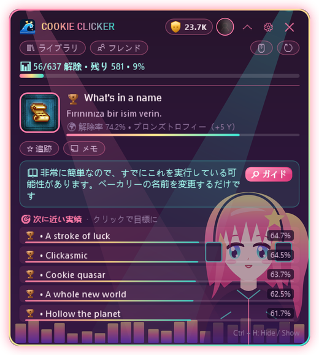

  

  
  
  
  

  <a href="README.md">English</a> · <a href="README.tr.md">Türkçe</a> · <a href="README.ru.md">Русский</a> · <a href="README.es.md">Español</a> · <a href="README.zh.md">中文</a> · <a href="README.de.md">Deutsch</a> · <a href="README.fr.md">Français</a> · <b>日本語</b>

---

**HundoHunter** は、ゲーム中に画面の隅に表示される小さなオーバーレイです。起動中の Steam ゲームを自動で認識し、**次に狙う実績**、**その取り方**、そして**永久に取り逃がすかもしれない実績**を教えてくれます。目標はひとつ：すべてのゲームを100%に、つまり *hundo* にすること。

しかも、ひとりで狩りをすることはありません。**ハンドたち** を紹介します 💖

  

## 💖 ハンドたちに会おう

ハンドたちは HundoHunter のテーマに住む女の子たちです。まばたきをして、ゆらゆら揺れて、しっぽを振って、**実績を解除するたびに大喜びでジャンプ**します。みんなそれぞれ得意な仕事があります：

<table>
<tr>
<td width="200" align="center"> <b>ネコ</b></td>
<td>
<b>追跡係。</b> ゲームが始まるとすぐに、ネコは<b>次の実績</b>をかぎつけて、説明と攻略ヒントを見せてくれます。ゴールが近いと耳がぴくっと動きます（例：<code>32/50</code> のような進行型実績）。
  <i>"にゃ〜 あと3つで君のものだよ！"</i>
</td>
</tr>
<tr>
<td width="200" align="center"> <b>ムーンライト</b></td>
<td>
<b>静かな見守り役。</b> ムーンライトはあなたの<b>ライブラリ</b>、<b>14日間の履歴</b>、そして<b>100%に一番近いゲーム</b>を見守ります。次に手が届く hundo がいつでもわかります。
  <i>"Stardew Valley は86%... 今夜クリアしちゃう？"</i>
</td>
</tr>
<tr>
<td width="200" align="center"> <b>ネオンリズム</b></td>
<td>
<b>応援団長。</b> 実績が解除されたら真っ先に気づくのが彼女：Steam 自身の通知と同じ瞬間に<b>即時検出</b>。トロフィーの音、通知、ジャンプ、そしてあなたの <b>Yスコア</b> がアップ。
  <i>"ダイヤモンドトロフィー！！持っているのはプレイヤーの1%未満だよ！"</i>
</td>
</tr>
<tr>
<td width="200" align="center"> <b>ゴシックプリンセス</b></td>
<td>
<b>守護者。</b> 手遅れになる前に<b>取り逃がし注意の実績</b>を知らせ（AI による検出）、<b>隠し実績をぼかして</b>ネタバレを防ぎます。
  <i>"気をつけて。この章を出たら、そのトロフィーは永遠に消えるわ。"</i>
</td>
</tr>
</table>

## ✨ 機能

<table>
<tr>
<td width="50%" valign="top"></td>
<td valign="top">
<h3> ゲーム内ガイド</h3>
<ul>
<li>起動中の Steam ゲームを自動検出</li>
<li>説明・レア度・攻略ヒント付きの<b>次の目標実績</b></li>
<li>レア度バー付きの<b>次に近い実績</b></li>
<li>好きな実績を目標として追跡、メモも追加</li>
<li><b>ボーダーレス / ウィンドウ化フルスクリーン</b>のゲームの上に表示</li>
</ul>
<h3> 即時解除</h3>
<ul>
<li>Steam 自身のローカル記録を読み取り：<b>Steam が表示するのと同じ瞬間</b>に実績が表示</li>
<li><i>ゲームの詳細</i>が非公開でも動作</li>
<li>オフラインキャッシュ：インターネットがなくても動作</li>
</ul>
</td>
</tr>
<tr>
<td valign="top">
<h3> サプライズなし、ネタバレなし</h3>
<ul>
<li><b>取り逃がし注意の実績</b>の警告（AI 支援：Gemini または OpenAI）</li>
<li>攻略テキストをあなたの言語に<b>自動翻訳</b></li>
<li><b>ネタバレ防止</b>：隠し実績は見たいときまでぼかしたまま</li>
</ul>
<h3> コレクションのすべて</h3>
<ul>
<li>各ゲームの進捗と<b>100%に最も近いゲーム</b>を表示するライブラリ</li>
<li>14日間の解除履歴グラフ</li>
<li><b>フレンドとの比較</b>とフレンドランキング</li>
<li>複数の Steam アカウントをワンクリックで切り替え</li>
</ul>
</td>
<td valign="top"></td>
</tr>
</table>

  &nbsp;&nbsp;
  

## 🏆 トロフィーランクと Yスコア

各実績には、解除したプレイヤーの割合に応じたランクがつき、ランクごとに専用の効果音があります。

| | ランク | 解除率 | ポイント |
|:-:|---|---|--:|
|  | **ブロンズ** | 50%以上 | 5 |
|  | **シルバー** | 20% – 50% | 15 |
|  | **ゴールド** | 5% – 20% | 40 |
|  | **サファイア** | 1% – 5% | 100 |
|  | **ダイヤモンド** | 1%未満 | 250 |

ゲームを100%にすると **+50 ボーナス**。ランクを上げよう：ルーキー → ブロンズハンター → シルバーハンター → ゴールドハンター → サファイアマスター → ダイヤモンドマスター → **レジェンド**。

## 🎨 20種類のテーマ（と、いくつかの秘密）

ほとんどのテーマはアニメーション付き。ハンドたちは **ネコ**、**ムーンライト**、**ネオンリズム**、**ゴシックプリンセス** のテーマに住んでいて、マスコットの友だちもいます。**自分の背景画像**をテーマと一緒に、または単独で設定することもできます。

  

> 🤫 リストに出てこないテーマもあります。ハンドたちは本物のハンターにだけパスワードをささやくらしい……

## 📥 ダウンロードと設定

1. [最新リリース](../../releases/latest)から **HundoHunter.zip** をダウンロードし、好きな場所に展開します。
2. `HundoHunter.exe` を実行します。ほかに何もインストールする必要はありません：.NET を含む単一ファイルです。 *アプリが署名されていないため、Windows に「Windows によって PC が保護されました」と表示されることがあります。**詳細情報 → 実行** をクリックしてください。*
3. <https://steamcommunity.com/dev/apikey> で無料の **Steam Web API キー** を取得し（ドメイン名は何でも OK、例：`localhost`）、設定に貼り付けます。
4. アカウントを追加：Steam プロフィールのリンク、カスタム URL 名、または17桁の Steam ID を入力します。
5. *（任意）* 取り逃がし検出と攻略翻訳のために **Google Gemini**（無料枠あり）または **OpenAI** のキーを追加します。
6. **保存して開始** を押し、Steam からゲームを起動して、ハンドにあいさつしましょう。

> 💡 ライブラリ・履歴・フレンド機能を使うには、**Steam → プロフィールを編集 → プライバシー設定 → ゲームの詳細** を **公開** にしてください。

### ショートカット

| キー | 動作 |
|---|---|
| `Ctrl` + `H` | オーバーレイの表示 / 非表示 |
| `Ctrl` + `Shift` + `H` | クリック透過モード（クリックがゲームに届く） |
| `Ctrl` + `Alt` + `K` | コンパクトモード |

すべてのショートカットは設定で変更できます。

## 🔒 プライバシー

- API キーはあなたの Windows アカウント専用に暗号化されます（Windows DPAPI）。
- Steam のローカル統計ファイルは**読み取る**だけで、変更しません。
- 背景画像はあなたの PC に残り、保存されるのは場所だけです。
- テレメトリーなし。HundoHunter が通信するのは Steam、選んだ AI サービス、翻訳サービスだけです。

## ❓ トラブルシューティング

| 問題 | 試してみること |
|---|---|
| ゲームの上に表示されない | ゲームを **ボーダーレス / ウィンドウ化フルスクリーン** にしてください。排他的フルスクリーンでは他のウィンドウを表示できません。 |
| 実績を読み込めない | API キーは正しいですか？ *ゲームの詳細* は公開になっていますか？ |
| 実績の表示が遅れる | Steam は起動していますか？ ゲームを Steam から起動しましたか？ |
| 違うゲームが検出される | *ゲームを手動で選択* にゲームの AppID（ストアのリンクにある数字）を入力してください。 |
| オーバーレイが消えた | `Ctrl` + `H` を押すか、トレイアイコンをクリックしてください。 |

## 💝 HundoHunter を応援する

HundoHunter は無料で、愛情を込めて作られています。hundo 達成の役に立ったなら、ハンドたちにおやつをごちそうしてください！ 応援のおかげで新しいテーマ、機能、そして新しいハンドが生まれます。

  
  

## 📜 法的情報とクレジット

HundoHunter は独立したファンプロジェクトであり、**Valve Corporation および Steam とは一切関係ありません**。Steam および Steam ロゴは Valve Corporation の商標です。ゲームと実績のデータは Steam Web API から取得しています。

ハンドたちとすべてのテーマのイラストは、HundoHunter のために描かれたオリジナルのベクター画像です。「Press Start 2P」フォント：CodeMan38、SIL Open Font License 1.1。

  💖 を込めて制作： <b>Wavemint</b> 
  

