

  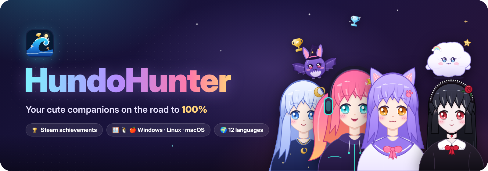

  
  
  
  
  

  <a href="README.md">English</a> · <a href="README.tr.md">Türkçe</a> · <a href="README.ru.md">Русский</a> · <a href="README.es.md">Español</a> · <a href="README.zh.md">中文</a> · <a href="README.de.md">Deutsch</a> · <a href="README.fr.md">Français</a> · <b>日本語</b>

---

  

**HundoHunter** は、ゲーム中に画面の隅に表示される小さなオーバーレイです。起動中の Steam ゲームを自動で認識し、**次に狙う実績**、**その取り方**、そして**永久に取り逃がすかもしれない実績**を教えてくれます。目標はひとつ：すべてのゲームを100%に、つまり *hundo* にすること。

しかも、ひとりで狩りをすることはありません。**ハンドたち** を紹介します 💖

  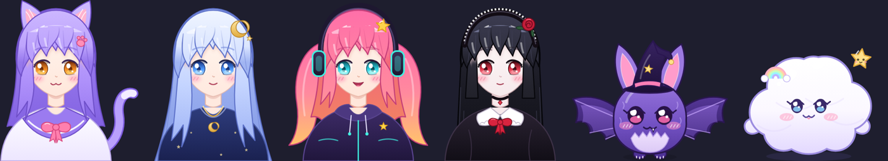

## 🆕 v4.2 の新機能

<h3>🎁 あなたの1年、あなたのランク</h3>

<table>
<tr>
<td width="44%" valign="top">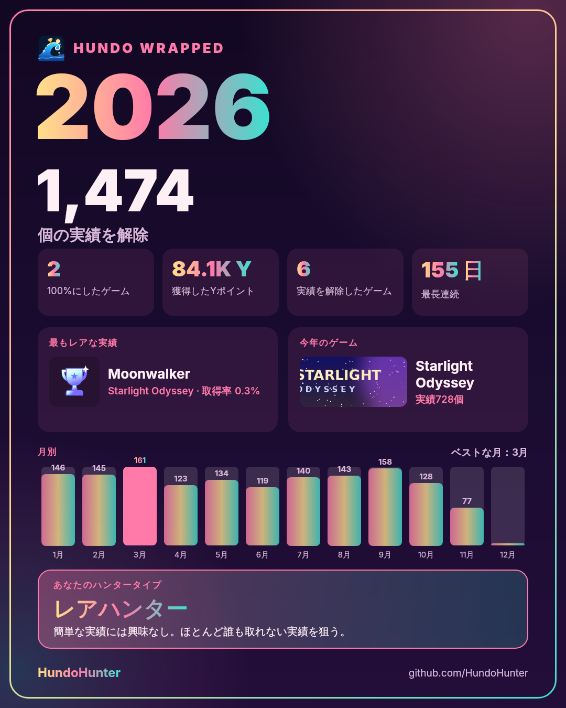</td>
<td valign="top">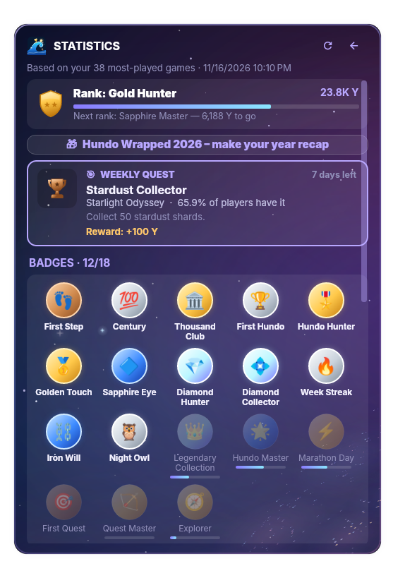
<ul>
<li><b>Hundo Wrapped</b>：1年のまとめカード（1080×1350）。実績数、100%達成、最もレアな実績、今年のゲーム、月別グラフ、あなたのハンタータイプ。</li>
<li><b>バッジとランク進捗</b>：進捗バー付きの18個のバッジと、次のランクまでの残り。</li>
<li><b>週間クエスト</b>：遊んでいるゲームからレアだけど達成できる実績を1つ。その週に解除すれば +100 Y。</li>
<li>進捗型実績の <b>「あと少し」通知</b> と、自分のペースから出す <b>100%までの目安時間</b>。</li>
</ul>
</td>
</tr>
</table>

<h3>📺 配信者モードとセカンドスクリーン</h3>

  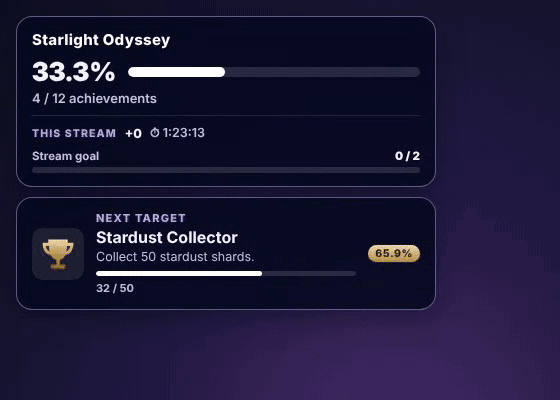

<table>
<tr>
<td width="66%" valign="top">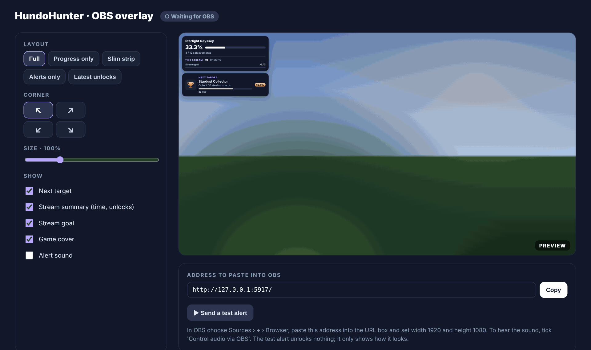
<ul>
<li><b>配信者モードを強化</b>：設定とプレビュー付きの新しいOBSオーバーレイ、配信目標、トロフィー色の紙吹雪通知、テスト通知、<b>Twitchチャットコマンド</b>（<code>!target</code>、<code>!progress</code>、<code>!rarest</code>）。</li>
<li>ウェブフックで <b>Discordチャンネルに投稿</b>：レア実績、すべて、または100%のみ。シェアカード付き。</li>
</ul>
</td>
<td valign="top">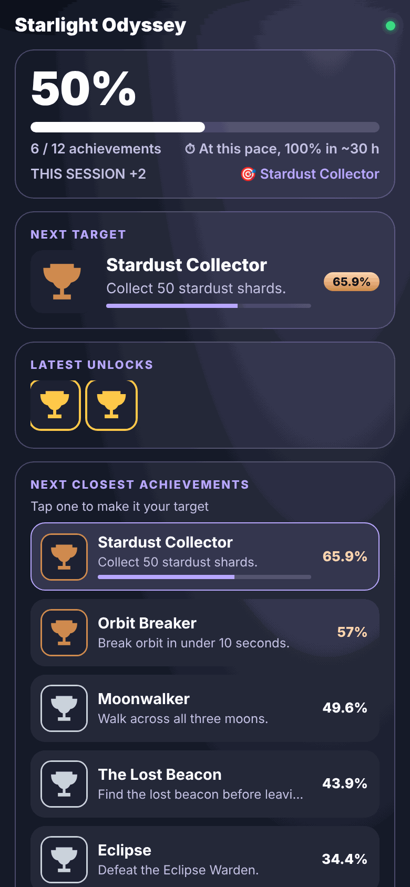
<ul>
<li><b>スマホをセカンドスクリーンに</b>：QRコードを読み取るとスマホにHUDを表示。実績をタップで目標に。自分のネットワーク内だけ、秘密キー付き。</li>
</ul>
</td>
</tr>
</table>

<h3>✨ さらに</h3>

<ul>
<li>手描きで物語のあるアニメーションの<b>新しいピクセルテーマ3種</b>：残り火と鋼、月夜の池、星の旅人。</li>
<li>新しい<b>起動アニメーション</b>：透明な波がトロフィーを運び、名前を書き上げます。アニメーションは <b>60 fps</b> になり、スクロールバーもテーマ色の細いデザインに。</li>
<li>設定から <b>ワンクリック更新</b>、全テーマでアニメーションがよりなめらかに。</li>
</ul>

## 🕹️ 新しいピクセルテーマ3種

すべて手描きのピクセルアート。数秒ごとにループする小さな物語があります。

<table>
<tr>
<td width="33%" align="center" valign="top">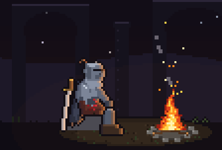 <b>残り火と鋼</b> 傷ついた騎士が、剣の刺さった焚き火のそばで休んでいます。</td>
<td width="33%" align="center" valign="top">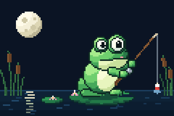 <b>月夜の池</b> 月明かりの池のほとりのカエル、ホタル、跳ねる魚。</td>
<td width="33%" align="center" valign="top">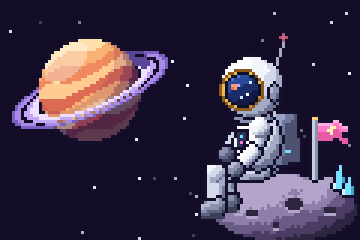 <b>星の旅人</b> 小さな宇宙飛行士が漂う岩に旗を立てます。</td>
</tr>
</table>

## 💖 ハンドたちに会おう

ハンドたちは HundoHunter のテーマに住む女の子たちです。まばたきをして、ゆらゆら揺れて、しっぽを振って、**実績を解除するたびに大喜びでジャンプ**します。みんなそれぞれ得意な仕事があります：

<table>
<tr>
<td width="200" align="center">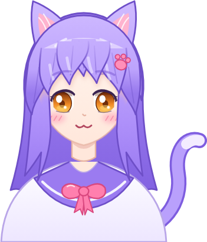 <b>ネコ</b></td>
<td>
<b>追跡係。</b> ゲームが始まるとすぐに、ネコは<b>次の実績</b>をかぎつけて、説明と攻略ヒントを見せてくれます。ゴールが近いと耳がぴくっと動きます（例：<code>32/50</code> のような進行型実績）。
  <i>"にゃ〜 あと3つで君のものだよ！"</i>
</td>
</tr>
<tr>
<td width="200" align="center">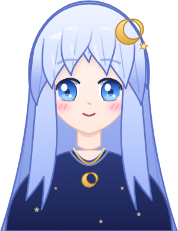 <b>ムーンライト</b></td>
<td>
<b>静かな見守り役。</b> ムーンライトはあなたの<b>ライブラリ</b>、<b>14日間の履歴</b>、そして<b>100%に一番近いゲーム</b>を見守ります。次に手が届く hundo がいつでもわかります。
  <i>"Stardew Valley は86%... 今夜クリアしちゃう？"</i>
</td>
</tr>
<tr>
<td width="200" align="center">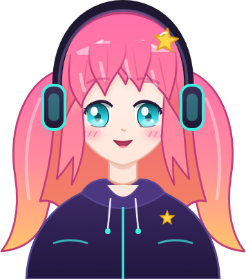 <b>ネオンリズム</b></td>
<td>
<b>応援団長。</b> 実績が解除されたら真っ先に気づくのが彼女：Steam 自身の通知と同じ瞬間に<b>即時検出</b>。トロフィーの音、通知、ジャンプ、そしてあなたの <b>Yスコア</b> がアップ。
  <i>"ダイヤモンドトロフィー！！持っているのはプレイヤーの1%未満だよ！"</i>
</td>
</tr>
<tr>
<td width="200" align="center">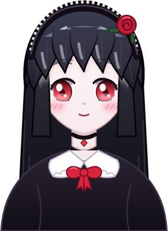 <b>ゴシックプリンセス</b></td>
<td>
<b>守護者。</b> 手遅れになる前に<b>取り逃がし注意の実績</b>を知らせ（AI による検出）、<b>隠し実績をぼかして</b>ネタバレを防ぎます。
  <i>"気をつけて。この章を出たら、そのトロフィーは永遠に消えるわ。"</i>
</td>
</tr>
</table>

そして2匹の小さなマスコット仲間：

<table>
<tr>
<td width="200" align="center">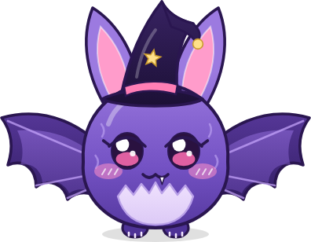 <b>真夜中コウモリ</b></td>
<td>
<b>夜ふかし担当。</b> <b>配信オーバーレイ</b>に寄り添います：目標バー、LIVEバッジ、視聴者向けの紙吹雪アラート。
  <i>"チャット見た？サファイアトロフィー！"</i>
</td>
</tr>
<tr>
<td width="200" align="center">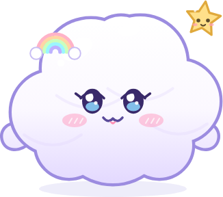 <b>わたぐもちゃん</b></td>
<td>
<b>夢見る子。</b> わたぐもちゃんは<b>統計</b>の上をふわふわ：バッジ、週間クエスト、そして年末の <b>Hundo Wrapped</b>。
  <i>"バッジあと4つ…いけるよ〜"</i>
</td>
</tr>
</table>

## ✨ 機能

<table>
<tr>
<td width="50%" valign="top">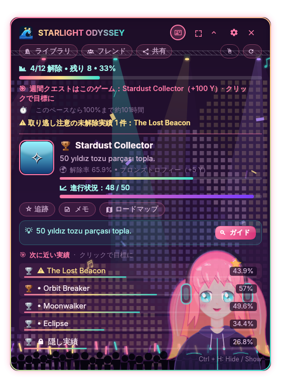</td>
<td valign="top">
<h3>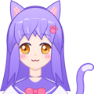 ゲーム内ガイド</h3>
<ul>
<li>起動中の Steam ゲームを自動検出</li>
<li>説明・レア度・攻略ヒント付きの<b>次の目標実績</b></li>
<li>レア度バー付きの<b>次に近い実績</b></li>
<li>好きな実績を目標として追跡、メモも追加</li>
<li><b>ボーダーレス / ウィンドウ化フルスクリーン</b>のゲームの上に表示</li>
</ul>
<h3> 即時解除</h3>
<ul>
<li>Steam 自身のローカル記録を読み取り：<b>Steam が表示するのと同じ瞬間</b>に実績が表示</li>
<li><i>ゲームの詳細</i>が非公開でも動作</li>
<li>オフラインキャッシュ：インターネットがなくても動作</li>
</ul>
</td>
</tr>
<tr>
<td valign="top">
<h3>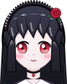 サプライズなし、ネタバレなし</h3>
<ul>
<li><b>取り逃がし注意の実績</b>の警告（AI 支援：Gemini または OpenAI）</li>
<li>攻略テキストをあなたの言語に<b>自動翻訳</b></li>
<li><b>ネタバレ防止</b>：隠し実績は見たいときまでぼかしたまま</li>
</ul>
<h3>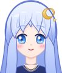 コレクションのすべて</h3>
<ul>
<li>各ゲームの進捗と<b>100%に最も近いゲーム</b>を表示するライブラリ</li>
<li>14日間の解除履歴グラフ</li>
<li><b>フレンドとの比較</b>とフレンドランキング</li>
<li>複数の Steam アカウントをワンクリックで切り替え</li>
</ul>
</td>
<td valign="top">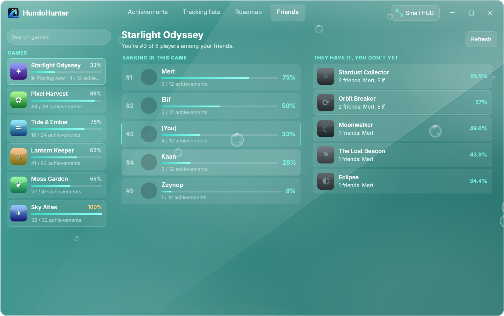</td>
</tr>
</table>

  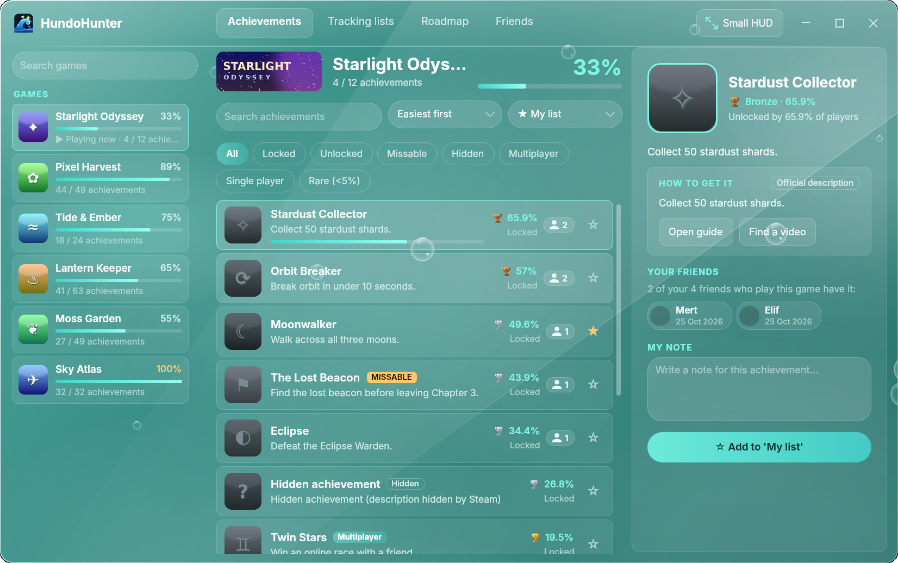

## 🏆 トロフィーランクと Yスコア

各実績には、解除したプレイヤーの割合に応じたランクがつき、ランクごとに専用の効果音があります。

| | ランク | 解除率 | ポイント |
|:-:|---|---|--:|
|  | **ブロンズ** | 50%以上 | 5 |
|  | **シルバー** | 20% – 50% | 15 |
|  | **ゴールド** | 5% – 20% | 40 |
|  | **サファイア** | 1% – 5% | 100 |
|  | **ダイヤモンド** | 1%未満 | 250 |

ゲームを100%にすると **+50 ボーナス**。ランクを上げよう：ルーキー → ブロンズハンター → シルバーハンター → ゴールドハンター → サファイアマスター → ダイヤモンドマスター → **レジェンド**。

## 🎨 35種類のテーマ（と、いくつかの秘密）

ほとんどのテーマはアニメーション付き。ハンドたちは **ネコ**、**ムーンライト**、**ネオンリズム**、**ゴシックプリンセス** のテーマに住んでいて、マスコットの友だちもいます。**自分の背景画像**をテーマと一緒に、または単独で設定することもできます。

  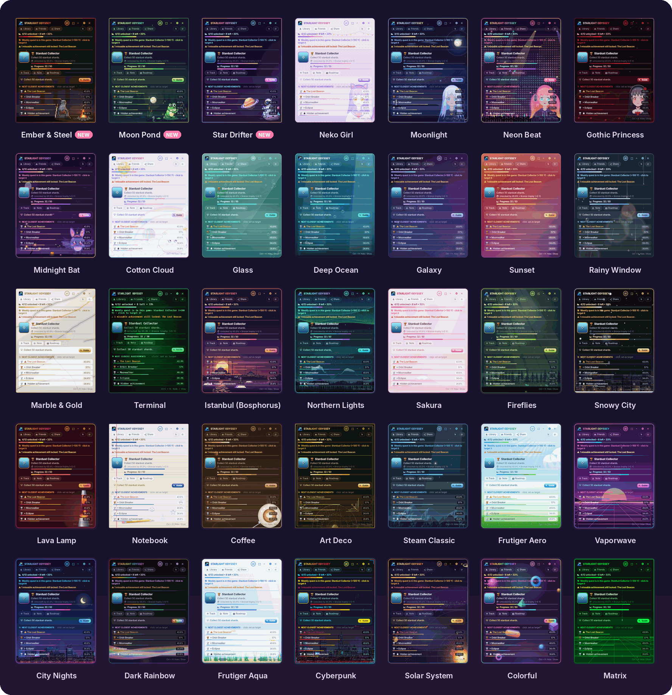

> 🤫 リストに出てこないテーマもあります。ハンドたちは本物のハンターにだけパスワードをささやくらしい……

## 📥 ダウンロードと設定

1. 🪟 **Windows:** [最新リリース](../../releases/latest)から **HundoHunter.zip** をダウンロードし、好きな場所に展開します。
2. `HundoHunter.exe` を実行します。ほかに何もインストールする必要はありません：.NET を含む単一ファイルです。 *アプリが署名されていないため、Windows に「Windows によって PC が保護されました」と表示されることがあります。**詳細情報 → 実行** をクリックしてください。*
   - 🐧 **Linux：** `HundoHunter-4.2.0-linux-x64.tar.gz` をダウンロードして展開し、`./install.sh` を実行します（アプリメニューに HundoHunter が追加されます）。X11 セッションで最もよく動作します。Wayland ではショートカットと最前面表示はデスクトップ環境によります。
   - 🍎 **macOS：** お使いの Mac に合った zip（M1〜M4 は `AppleSilicon`、それ以前の Mac は `Intel`）をダウンロードして展開し、`HundoHunter.app` をアプリケーションに移動します。アプリは署名されていないため、初回は右クリックして **開く** を選んでください。
   - 🎮 **Steam Deck：** Linux 版を使ってください。ゲームモードでは小さな HUD がゲームの上に表示され、コントローラーで切り替えられます。大きなウィンドウは Steam Deck では使えません。
3. <https://steamcommunity.com/dev/apikey> で無料の **Steam Web API キー** を取得し（ドメイン名は何でも OK、例：`localhost`）、設定に貼り付けます。
4. アカウントを追加：Steam プロフィールのリンク、カスタム URL 名、または17桁の Steam ID を入力します。
5. *（任意）* 取り逃がし検出と攻略翻訳のために **Google Gemini**（無料枠あり）または **OpenAI** のキーを追加します。
6. **保存して開始** を押し、Steam からゲームを起動して、ハンドにあいさつしましょう。

> 💡 ライブラリ・履歴・フレンド機能を使うには、**Steam → プロフィールを編集 → プライバシー設定 → ゲームの詳細** を **公開** にしてください。

### ショートカット

| キー | 動作 |
|---|---|
| `Ctrl` + `H` | オーバーレイの表示 / 非表示 |
| `Ctrl` + `Shift` + `H` | クリック透過モード（クリックがゲームに届く） |
| `Ctrl` + `Shift` + `A` | 大きなウィンドウを開く |
| `Ctrl` + `1` … `4` | 大きなウィンドウのタブを切り替え |

すべてのショートカットは設定で変更できます。コンパクトモードと更新には初期設定のキーがありません。コントローラーでもオーバーレイを切り替えられます。

## 🔒 プライバシー

- API キーはあなたのアカウント専用に暗号化されます（Windows では Windows DPAPI、Linux と macOS ではあなただけが読める専用のキーファイル）。
- Steam のローカル統計ファイルは**読み取る**だけで、変更しません。
- 背景画像はあなたの PC に残り、保存されるのは場所だけです。
- テレメトリーなし。HundoHunter が通信するのは Steam、選んだ AI サービス、翻訳サービス、GitHub（更新の確認）だけです。
- 配信用オーバーレイページは自分のパソコン（127.0.0.1）からしか開けません。
- スクリーンショットとシェアカードは「ピクチャ」フォルダーに保存され、何もアップロードされません。
- Discord ステータスは任意で、パソコン上の Discord アプリを通してのみ送られます。
- 不具合報告は送信前に内容を確認できる GitHub の Issue を開きます。API キー、Steam ID、メールアドレス、ユーザー名は伏せられます。
- スマホページは自分のネットワーク内でのみ動作し、QRコードの秘密キーが必要です。
- Discord Webhook のアドレスは API キーと同様に暗号化して保存されます。
- Twitch チャットは匿名・読み取り専用で読み込みます。HundoHunter がチャットに書き込むことはありません。

## ❓ トラブルシューティング

| 問題 | 試してみること |
|---|---|
| ゲームの上に表示されない | ゲームを **ボーダーレス / ウィンドウ化フルスクリーン** にしてください。排他的フルスクリーンでは他のウィンドウを表示できません。 |
| 実績を読み込めない | API キーは正しいですか？ *ゲームの詳細* は公開になっていますか？ |
| 実績の表示が遅れる | Steam は起動していますか？ ゲームを Steam から起動しましたか？ |
| 違うゲームが検出される | *ゲームを手動で選択* にゲームの AppID（ストアのリンクにある数字）を入力してください。 |
| オーバーレイが消えた | `Ctrl` + `H` を押すか、トレイアイコンをクリックしてください。 |
| スマホページが開かない | スマホを同じ Wi-Fi に接続し、ファイアウォールで HundoHunter を許可してください（プライベートネットワーク）。 |
| Discord に投稿されない | 設定の<b>テスト送信</b>を使い、Webhook URL が完全か、チャンネルが存在するか確認してください。 |

## 💝 HundoHunter を応援する

HundoHunter は無料で、愛情を込めて作られています。hundo 達成の役に立ったなら、ハンドたちにおやつをごちそうしてください！ 応援のおかげで新しいテーマ、機能、そして新しいハンドが生まれます。

  
  

<b>以前：v4.1 で追加された機能</b>

- **大きなウィンドウ**（`Ctrl` + `Shift` + `A`）：すべてのゲームと実績を並べて表示。フィルター、並べ替え、攻略、メモ、フレンド付き。検索は一度も起動していないものを含め、持っているすべてのゲームを見つけ、タイプミスも許してくれます。
- **追跡リスト**：好きなゲームの実績を名前付きリストにまとめられます。小さな HUD には選んだリストが表示されます。
- **100% ロードマップ**：AI がゲームの実績を無理のない段階に分けます。取り逃し注意の実績は最初に、作業系は最後に。
- **フレンドタブ**：ゲームごとのランキング、「フレンドは持っていて自分は持っていない」実績、誰がいつ何を解除したか。フレンドに抜かれたら通知も。
- **統計とセッションのまとめ**：合計、連続記録、月別グラフ。プレイを終えるたびに短いカードも表示されます。
- **シェアカード**：テーマの色で作られる 1200×630 の進捗画像。実績を解除した瞬間のスクリーンショット付き。
- **配信者モード**：OBS / Streamlabs 用の透過オーバーレイページ（ブラウザソース）。
- **Discord ステータス**、**コントローラーでの表示切替**（Xbox、PlayStation、Steam Deck／Windows と Linux）、**Steam Deck のゲームモード**に対応。
- **隠し実績の説明**を Steam 自身のデータから補完。見たいと言うまではぼかしたままです。
- **ワンクリック更新**（SHA256 で検証）と、キーや ID を隠してくれる**不具合報告**ボタン。
- **4 つの新言語**：Português (BR)、Polski、한국어、Italiano（合計 12 言語）。
- **32 種類のテーマ**、うち 8 つが新登場：ガラス、深海、銀河、夕焼け、雨の窓、大理石と金、ターミナル、イスタンブール（ボスポラス）。すべてのテーマを描き直し、アニメーションはより滑らかで軽くなりました。

## 📜 法的情報とクレジット

HundoHunter は独立したファンプロジェクトであり、**Valve Corporation および Steam とは一切関係ありません**。Steam および Steam ロゴは Valve Corporation の商標です。ゲームと実績のデータは Steam Web API から取得しています。

ハンドたちとすべてのテーマのイラストは、HundoHunter のために描かれたオリジナルのベクター画像です。「Press Start 2P」フォント：CodeMan38、SIL Open Font License 1.1。「Mr Dafoe」フォント：Alejandro Paul (Sudtipos)、SIL Open Font License 1.1。アイコン：Pictogrammers の Material Design Icons、Apache License 2.0。 3つのピクセルテーマは HundoHunter のために描かれたオリジナルのピクセルアートです。

  💖 を込めて制作： <b>Wavemint</b> 
  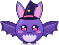

