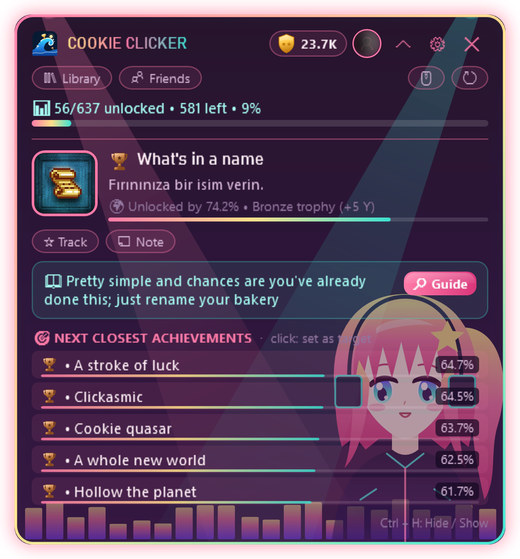

  

  
  
  
  

  <b>English</b> · <a href="README.tr.md">Türkçe</a> · <a href="README.ru.md">Русский</a> · <a href="README.es.md">Español</a> · <a href="README.zh.md">中文</a> · <a href="README.de.md">Deutsch</a> · <a href="README.fr.md">Français</a> · <a href="README.ja.md">日本語</a>

---

**HundoHunter** is a small overlay that sits in the corner of your screen while you play. It recognizes the Steam game you're running and tells you **which achievement to chase next**, **how to get it**, and **which ones you could miss forever**. One goal: 100% every game, a *hundo*.

And you're never hunting alone. Meet the **Hundos** 💖

  

## 💖 Meet the Hundos

The Hundos are the little girls who live in HundoHunter's themes. They blink, sway, wag their tails and **jump for joy every time you unlock an achievement**. Each one has a favorite job:

<table>
<tr>
<td width="200" align="center"> <b>Neko</b></td>
<td>
<b>The tracker.</b> Neko sniffs out your <b>next achievement</b> the moment a game starts, with its description and a guide hint. Her ears twitch when something is close (e.g. <code>32/50</code> progress achievements).
  <i>"Nyaa~ only three more and it's yours!"</i>
</td>
</tr>
<tr>
<td width="200" align="center"> <b>Moonlight</b></td>
<td>
<b>The quiet keeper.</b> Moonlight watches over your <b>library</b>, your <b>14-day history</b> and the games <b>closest to 100%</b>, so you always know which hundo is within reach.
  <i>"Stardew Valley is at 86%... shall we finish it tonight?"</i>
</td>
</tr>
<tr>
<td width="200" align="center"> <b>Neon Rhythm</b></td>
<td>
<b>The cheerleader.</b> When an achievement pops, she's the first to know: <b>instant detection</b>, at the very same moment as Steam's own notification. Trophy sound, a toast, a jump, and your <b>Y Score</b> goes up.
  <i>"Diamond trophy!! Less than 1% of players have this one!"</i>
</td>
</tr>
<tr>
<td width="200" align="center"> <b>Gothic Princess</b></td>
<td>
<b>The guardian.</b> She warns you about <b>missable achievements</b> before it's too late (AI-assisted detection) and keeps <b>hidden achievements blurred</b> so nothing gets spoiled.
  <i>"Careful. Once you leave this chapter, that trophy is gone."</i>
</td>
</tr>
</table>

## ✨ Features

<table>
<tr>
<td width="50%" valign="top"></td>
<td valign="top">
<h3> In-game guide</h3>
<ul>
<li>Detects the running Steam game automatically</li>
<li><b>Next target achievement</b> with description, rarity and guide hint</li>
<li><b>Next closest achievements</b> with rarity bars</li>
<li>Track any achievement as your target, add personal notes</li>
<li>Works on top of games in <b>borderless / windowed fullscreen</b></li>
</ul>
<h3> Instant unlocks</h3>
<ul>
<li>Reads Steam's own local records: unlocks appear <b>the second Steam shows them</b></li>
<li>Works even if your <i>Game details</i> are private</li>
<li>Offline cache: still works without internet</li>
</ul>
</td>
</tr>
<tr>
<td valign="top">
<h3> No surprises, no spoilers</h3>
<ul>
<li><b>Missable achievement</b> warnings (AI-assisted: Gemini or OpenAI)</li>
<li>Guide texts <b>auto-translated</b> to your language</li>
<li><b>Spoiler protection</b>: hidden achievements stay blurred until you ask</li>
</ul>
<h3> Your whole collection</h3>
<ul>
<li>Library with every game's progress and the <b>closest to 100%</b></li>
<li>14-day unlock history graph</li>
<li><b>Friends comparison</b> and a friends leaderboard</li>
<li>Multiple Steam accounts, switch with one click</li>
</ul>
</td>
<td valign="top"></td>
</tr>
</table>

  &nbsp;&nbsp;
  

## 🏆 Trophy tiers & Y Score

Every achievement gets a tier based on how many players have unlocked it, and each tier has its own sound.

| | Tier | Unlocked by | Points |
|:-:|---|---|--:|
|  | **Bronze** | 50% and more | 5 |
|  | **Silver** | 20% – 50% | 15 |
|  | **Gold** | 5% – 20% | 40 |
|  | **Sapphire** | 1% – 5% | 100 |
|  | **Diamond** | under 1% | 250 |

Finish a game at 100% for a **+50 bonus**. Climb the ranks: Rookie → Bronze Hunter → Silver Hunter → Gold Hunter → Sapphire Master → Diamond Master → **Legend**.

## 🎨 20 themes (and a few secrets)

Most themes are animated. The Hundos live in **Neko**, **Moonlight**, **Neon Rhythm** and **Gothic Princess**, and they've got mascot friends too. You can even set **your own background image**, together with a theme or on its own.

  

> 🤫 Some themes don't show up in the list. Rumor has it the Hundos whisper the passwords to true hunters...

## 📥 Download & setup

1. Download **HundoHunter.zip** from the [latest release](../../releases/latest) and unzip it anywhere.
2. Run `HundoHunter.exe`. Nothing else to install: it's a single file with .NET included. *Windows may say "Windows protected your PC" because the app isn't signed. Click **More info → Run anyway**.*
3. Get a free **Steam Web API key** at <https://steamcommunity.com/dev/apikey> (any domain name works, e.g. `localhost`) and paste it into the settings.
4. Add your account: paste your Steam profile link, custom URL name or 17-digit Steam ID.
5. *(Optional)* Add a **Google Gemini** (free tier) or **OpenAI** key for missable detection and guide translation.
6. Press **Save & Start**, launch a game from Steam, and say hi to your Hundo.

> 💡 For the library, history and friends features, set **Steam → Edit Profile → Privacy → Game details** to **Public**.

### Hotkeys

| Keys | Action |
|---|---|
| `Ctrl` + `H` | Show / hide the overlay |
| `Ctrl` + `Shift` + `H` | Click-through mode (clicks go to the game) |
| `Ctrl` + `Alt` + `K` | Compact mode |

All hotkeys can be changed in the settings.

## 🔒 Privacy

- API keys are encrypted for your Windows account only (Windows DPAPI).
- Steam's local stats files are only **read**, never changed.
- Your background image stays on your computer; only its location is saved.
- No telemetry. HundoHunter only talks to Steam, the AI service you choose and the translation service.

## ❓ Troubleshooting

| Problem | Try this |
|---|---|
| Not visible over the game | Switch the game to **Borderless / Windowed fullscreen**. Exclusive fullscreen can't show other windows. |
| Achievements can't be read | Is your API key correct? Is *Game details* public? |
| Unlocks show up late | Is Steam running, and did you start the game through Steam? |
| Wrong game detected | Type the game's AppID (the number in its store link) into *Pick game manually*. |
| Overlay disappeared | Press `Ctrl` + `H` or click the tray icon. |

## 💝 Support HundoHunter

HundoHunter is free and made with love. If it helped you finish a hundo, you can buy the Hundos a treat! Every bit keeps new themes, features and Hundos coming.

  
  

## 📜 Legal & credits

HundoHunter is an independent fan project and is **not affiliated with Valve Corporation or Steam**. Steam and the Steam logo are trademarks of Valve Corporation. Game and achievement data come from the Steam Web API.

The Hundos and all theme artwork are original vector drawings made for HundoHunter. "Press Start 2P" font by CodeMan38, SIL Open Font License 1.1.

  Made with 💖 by <b>Wavemint</b> 
  

