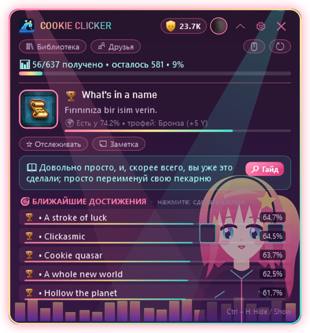

  

  
  
  
  

  <a href="README.md">English</a> · <a href="README.tr.md">Türkçe</a> · <b>Русский</b> · <a href="README.es.md">Español</a> · <a href="README.zh.md">中文</a> · <a href="README.de.md">Deutsch</a> · <a href="README.fr.md">Français</a> · <a href="README.ja.md">日本語</a>

---

**HundoHunter** — это небольшое окно-оверлей в углу экрана во время игры. Оно само распознаёт запущенную игру Steam и подсказывает, **какое достижение взять следующим**, **как его получить** и **какие можно упустить навсегда**. Цель одна: пройти каждую игру на 100% — сделать *hundo*.

И на охоте ты никогда не один. Знакомься: **Хандо** 💖

  

## 💖 Знакомьтесь, Хандо

Хандо — маленькие девочки, которые живут в темах HundoHunter. Они моргают, покачиваются, виляют хвостиком и **прыгают от радости каждый раз, когда ты открываешь достижение**. У каждой своя любимая работа:

<table>
<tr>
<td width="200" align="center"> <b>Неко</b></td>
<td>
<b>Следопыт.</b> Неко с первых секунд игры чует твоё <b>следующее достижение</b> и показывает его описание и подсказку из гайда. Её ушки дёргаются, когда цель близко (например, достижения с прогрессом <code>32/50</code>).
  <i>"Мяу~ ещё три — и оно твоё!"</i>
</td>
</tr>
<tr>
<td width="200" align="center"> <b>Лунный свет</b></td>
<td>
<b>Тихая хранительница.</b> Лунный свет присматривает за твоей <b>библиотекой</b>, <b>историей за 14 дней</b> и играми, <b>ближе всего к 100%</b>, — ты всегда знаешь, какой hundo совсем рядом.
  <i>"Stardew Valley уже на 86%... может, добьём сегодня?"</i>
</td>
</tr>
<tr>
<td width="200" align="center"> <b>Неоновый ритм</b></td>
<td>
<b>Группа поддержки.</b> Когда достижение открывается, она узнаёт первой: <b>мгновенное обнаружение</b> в ту же секунду, что и уведомление Steam. Звук трофея, всплывашка, прыжок — и твой <b>Y-счёт</b> растёт.
  <i>"Алмазный трофей!! Его открыли меньше 1% игроков!"</i>
</td>
</tr>
<tr>
<td width="200" align="center"> <b>Готическая принцесса</b></td>
<td>
<b>Стражница.</b> Она заранее предупреждает о <b>пропускаемых достижениях</b> (определение с помощью ИИ) и <b>размывает скрытые достижения</b>, чтобы ничего не проспойлерить.
  <i>"Осторожно. Уйдёшь из этой главы — и трофей потерян навсегда."</i>
</td>
</tr>
</table>

## ✨ Возможности

<table>
<tr>
<td width="50%" valign="top"></td>
<td valign="top">
<h3> Гид прямо в игре</h3>
<ul>
<li>Автоматически определяет запущенную игру Steam</li>
<li><b>Следующая цель</b> с описанием, редкостью и подсказкой</li>
<li><b>Ближайшие достижения</b> с полосками редкости</li>
<li>Отслеживай любое достижение и добавляй свои заметки</li>
<li>Работает поверх игр в режиме <b>без рамки / оконный полноэкранный</b></li>
</ul>
<h3> Мгновенные разблокировки</h3>
<ul>
<li>Читает локальные записи самого Steam: достижение появляется <b>в ту же секунду, что и в Steam</b></li>
<li>Работает, даже если <i>Сведения об играх</i> скрыты</li>
<li>Офлайн-кэш: работает и без интернета</li>
</ul>
</td>
</tr>
<tr>
<td valign="top">
<h3> Без сюрпризов и спойлеров</h3>
<ul>
<li>Предупреждения о <b>пропускаемых достижениях</b> (с помощью ИИ: Gemini или OpenAI)</li>
<li>Тексты гайдов <b>автоматически переводятся</b> на твой язык</li>
<li><b>Защита от спойлеров</b>: скрытые достижения размыты, пока ты сам не захочешь</li>
</ul>
<h3> Вся твоя коллекция</h3>
<ul>
<li>Библиотека с прогрессом каждой игры и <b>ближайшими к 100%</b></li>
<li>График разблокировок за 14 дней</li>
<li><b>Сравнение с друзьями</b> и таблица лидеров</li>
<li>Несколько аккаунтов Steam, переключение в один клик</li>
</ul>
</td>
<td valign="top"></td>
</tr>
</table>

  &nbsp;&nbsp;
  

## 🏆 Уровни трофеев и Y-счёт

Каждое достижение получает уровень в зависимости от того, сколько игроков его открыли, и у каждого уровня свой звук.

| | Уровень | Открыли | Очки |
|:-:|---|---|--:|
|  | **Бронза** | 50% и больше | 5 |
|  | **Серебро** | 20% – 50% | 15 |
|  | **Золото** | 5% – 20% | 40 |
|  | **Сапфир** | 1% – 5% | 100 |
|  | **Алмаз** | меньше 1% | 250 |

Пройди игру на 100% и получи **+50 бонусных очков**. Расти в рангах: Новичок → Бронзовый охотник → Серебряный охотник → Золотой охотник → Сапфировый мастер → Алмазный мастер → **Легенда**.

## 🎨 20 тем (и несколько секретных)

Большинство тем анимированы. Хандо живут в темах **Неко**, **Лунный свет**, **Неоновый ритм** и **Готическая принцесса**, а ещё у них есть друзья-маскоты. Можно даже поставить **свою картинку на фон** — вместе с темой или отдельно.

  

> 🤫 Некоторых тем нет в списке. Говорят, Хандо шепчут пароли только настоящим охотникам...

## 📥 Скачивание и настройка

1. Скачай **HundoHunter.zip** из [последнего релиза](../../releases/latest) и распакуй куда угодно.
2. Запусти `HundoHunter.exe`. Больше ничего ставить не нужно: это один файл, .NET уже внутри. *Windows может показать «Система Windows защитила ваш компьютер», потому что приложение не подписано. Нажми **Подробнее → Выполнить в любом случае**.*
3. Получи бесплатный **ключ Steam Web API** на <https://steamcommunity.com/dev/apikey> (подойдёт любое доменное имя, например `localhost`) и вставь его в настройках.
4. Добавь аккаунт: ссылку на профиль Steam, свой URL или 17-значный Steam ID.
5. *(Необязательно)* Добавь ключ **Google Gemini** (есть бесплатный уровень) или **OpenAI** для поиска пропускаемых достижений и перевода гайдов.
6. Нажми **Сохранить и запустить**, запусти игру в Steam и поздоровайся со своей Хандо.

> 💡 Для библиотеки, истории и друзей сделай **Steam → Редактировать профиль → Приватность → Сведения об играх** открытыми (**Открытый**).

### Горячие клавиши

| Клавиши | Действие |
|---|---|
| `Ctrl` + `H` | Показать / скрыть оверлей |
| `Ctrl` + `Shift` + `H` | Режим «сквозных» кликов (клики идут в игру) |
| `Ctrl` + `Alt` + `K` | Компактный режим |

Все сочетания можно изменить в настройках.

## 🔒 Конфиденциальность

- API-ключи шифруются только для твоей учётной записи Windows (Windows DPAPI).
- Локальные файлы статистики Steam только **читаются** и никогда не изменяются.
- Картинка фона остаётся на твоём компьютере; сохраняется лишь путь к ней.
- Никакой телеметрии. HundoHunter общается только со Steam, выбранным ИИ-сервисом и сервисом перевода.

## ❓ Решение проблем

| Проблема | Что сделать |
|---|---|
| Не видно поверх игры | Переключи игру в режим **без рамки / оконный полноэкранный**. В эксклюзивном полноэкранном режиме другие окна не отображаются. |
| Не удаётся прочитать достижения | Правильный ли API-ключ? Открыты ли *Сведения об играх*? |
| Достижения появляются с задержкой | Запущен ли Steam и запущена ли игра через Steam? |
| Определена не та игра | Впиши AppID игры (число из ссылки на магазин) в поле *Выбрать игру вручную*. |
| Оверлей пропал | Нажми `Ctrl` + `H` или щёлкни по значку в трее. |

## 💝 Поддержать HundoHunter

HundoHunter бесплатен и сделан с любовью. Если он помог тебе закрыть hundo, угости Хандо вкусняшкой! Любая поддержка помогает выпускать новые темы, функции и новых Хандо.

  
  

## 📜 Правовая информация и авторы

HundoHunter — независимый фанатский проект и **не связан с Valve Corporation или Steam**. Steam и логотип Steam — товарные знаки Valve Corporation. Данные об играх и достижениях берутся из Steam Web API.

Хандо и все рисунки тем — оригинальная векторная графика, созданная для HundoHunter. Шрифт «Press Start 2P»: CodeMan38, SIL Open Font License 1.1.

  Сделано с 💖 — <b>Wavemint</b> 
  

