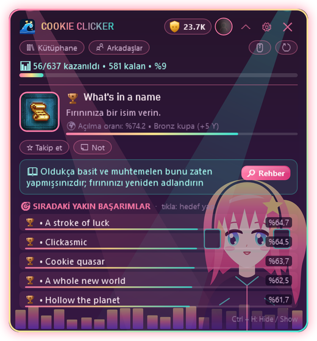

  

  
  
  
  

  <a href="README.md">English</a> · <b>Türkçe</b> · <a href="README.ru.md">Русский</a> · <a href="README.es.md">Español</a> · <a href="README.zh.md">中文</a> · <a href="README.de.md">Deutsch</a> · <a href="README.fr.md">Français</a> · <a href="README.ja.md">日本語</a>

---

**HundoHunter**, oyun oynarken ekranın köşesinde duran küçük bir penceredir. Açtığın Steam oyununu kendisi tanır; **sıradaki başarımı**, **ona nasıl ulaşacağını** ve **sonsuza dek kaçırabileceğin başarımları** gösterir. Tek hedef: her oyunu %100 bitirmek, yani bir *hundo*.

Üstelik avda hiç yalnız değilsin. Karşında **Hundolar** 💖

  

## 💖 Hundolarla tanış

Hundolar, HundoHunter'ın temalarında yaşayan küçük kızlardır. Göz kırparlar, saçlarını savururlar, kuyruk sallarlar ve **her başarım açtığında sevinçten zıplarlar**. Her birinin en sevdiği bir görevi var:

<table>
<tr>
<td width="200" align="center"> <b>Kedi Kız</b></td>
<td>
<b>İz sürücü.</b> Oyun açılır açılmaz <b>sıradaki başarımının</b> kokusunu alır; açıklamasını ve rehber ipucunu önüne koyar. Bir başarım yaklaştığında kulakları seğirir (örn. <code>32/50</code> ilerlemeli başarımlar).
  <i>"Miyav~ üç tane daha, sonra o kupa senin!"</i>
</td>
</tr>
<tr>
<td width="200" align="center"> <b>Ay Işığı</b></td>
<td>
<b>Sessiz bekçi.</b> <b>Kütüphaneni</b>, <b>son 14 günlük geçmişini</b> ve <b>%100'e en yakın oyunlarını</b> gözetir; hangi hundonun bir adım ötede olduğunu hep bilirsin.
  <i>"Stardew Valley %86'da... bu gece bitirelim mi?"</i>
</td>
</tr>
<tr>
<td width="200" align="center"> <b>Neon Ritim</b></td>
<td>
<b>Ponpon kız.</b> Bir başarım açıldığında ilk o duyar: <b>anlık yakalama</b>, Steam'in kendi bildirimiyle aynı saniyede. Kupa sesi, bildirim, bir zıplama ve <b>Y Puanın</b> artar.
  <i>"Elmas kupa!! Bunu oyuncuların %1'inden azı açabildi!"</i>
</td>
</tr>
<tr>
<td width="200" align="center"> <b>Gotik Prenses</b></td>
<td>
<b>Koruyucu.</b> <b>Kaçırılabilir başarımlar</b> için iş işten geçmeden uyarır (yapay zekâ destekli tespit) ve <b>gizli başarımları bulanık</b> tutar; hiçbir sürpriz bozulmaz.
  <i>"Dikkat et. Bu bölümden çıkarsan o kupa sonsuza dek gider."</i>
</td>
</tr>
</table>

## ✨ Özellikler

<table>
<tr>
<td width="50%" valign="top"></td>
<td valign="top">
<h3> Oyun içi rehber</h3>
<ul>
<li>Çalışan Steam oyununu otomatik tanır</li>
<li>Açıklaması, nadirliği ve rehber ipucuyla <b>sıradaki hedef başarım</b></li>
<li>Nadirlik çubuklarıyla <b>sıradaki yakın başarımlar</b></li>
<li>İstediğin başarımı takibe al, kendi notlarını ekle</li>
<li><b>Kenarlıksız / pencereli tam ekran</b> oyunların üstünde çalışır</li>
</ul>
<h3> Anlık başarım</h3>
<ul>
<li>Steam'in bilgisayardaki kendi kayıtlarını okur: başarım <b>Steam gösterdiği an</b> düşer</li>
<li><i>Oyun ayrıntıları</i> gizli olsa bile çalışır</li>
<li>Çevrimdışı önbellek: internet yokken de çalışır</li>
</ul>
</td>
</tr>
<tr>
<td valign="top">
<h3> Sürpriz yok, spoiler yok</h3>
<ul>
<li><b>Kaçırılabilir başarım</b> uyarıları (yapay zekâ destekli: Gemini veya OpenAI)</li>
<li>Rehber metinleri seçtiğin dile <b>otomatik çevrilir</b></li>
<li><b>Spoiler koruması</b>: gizli başarımlar sen istemedikçe bulanık kalır</li>
</ul>
<h3> Tüm koleksiyonun</h3>
<ul>
<li>Her oyunun ilerlemesi ve <b>%100'e en yakınlar</b> ile kütüphane</li>
<li>Son 14 günün başarım grafiği</li>
<li><b>Arkadaşlarla karşılaştırma</b> ve arkadaş sıralaması</li>
<li>Birden fazla Steam hesabı, tek tıkla geçiş</li>
</ul>
</td>
<td valign="top"></td>
</tr>
</table>

  &nbsp;&nbsp;
  

## 🏆 Kupa seviyeleri ve Y Puanı

Her başarım, oyuncuların yüzde kaçının açtığına göre bir kupa seviyesi alır; her seviyenin kendi sesi vardır.

| | Seviye | Açan oyuncu | Puan |
|:-:|---|---|--:|
|  | **Bronz** | %50 ve üzeri | 5 |
|  | **Gümüş** | %20 – %50 | 15 |
|  | **Altın** | %5 – %20 | 40 |
|  | **Safir** | %1 – %5 | 100 |
|  | **Elmas** | %1'in altında | 250 |

Bir oyunu %100 bitirirsen **+50 bonus**. Rütbe atla: Çaylak → Bronz Avcı → Gümüş Avcı → Altın Avcı → Safir Usta → Elmas Usta → **Efsane**.

## 🎨 20 tema (ve birkaç sır)

Temaların çoğu hareketli. Hundolar **Kedi Kız**, **Ay Işığı**, **Neon Ritim** ve **Gotik Prenses** temalarında yaşıyor, maskot arkadaşları da var. Hatta **kendi arka plan resmini** de koyabilirsin: temayla birlikte ya da tek başına.

  

> 🤫 Bazı temalar listede görünmüyor. Söylentiye göre Hundolar şifreleri sadece gerçek avcılara fısıldıyormuş...

## 📥 İndirme ve kurulum

1. [Son sürümden](../../releases/latest) **HundoHunter.zip** dosyasını indir ve istediğin yere çıkar.
2. `HundoHunter.exe`'yi çalıştır. Başka bir şey kurmana gerek yok: .NET dahil her şey tek dosyanın içinde. *Uygulama imzasız olduğu için Windows "Bilgisayarınız korundu" diyebilir. **Ek bilgi → Yine de çalıştır**'a bas.*
3. <https://steamcommunity.com/dev/apikey> adresinden ücretsiz bir **Steam Web API anahtarı** al (alan adına herhangi bir şey yazabilirsin, örn. `localhost`) ve ayarlara yapıştır.
4. Hesabını ekle: Steam profil bağlantını, özel URL adını ya da 17 haneli Steam ID'ni yaz.
5. *(İsteğe bağlı)* Kaçırılabilir tespiti ve rehber çevirisi için **Google Gemini** (ücretsiz katmanı var) ya da **OpenAI** anahtarı gir.
6. **Kaydet ve Başlat**'a bas, Steam'den bir oyun aç ve Hundona merhaba de.

> 💡 Kütüphane, geçmiş ve arkadaş özellikleri için **Steam → Profili Düzenle → Gizlilik → Oyun ayrıntıları** ayarını **Herkese açık** yap.

### Kısayollar

| Tuşlar | İşlev |
|---|---|
| `Ctrl` + `H` | Pencereyi gizle / göster |
| `Ctrl` + `Shift` + `H` | Tıklama geçirgen mod (tıklamalar oyuna geçer) |
| `Ctrl` + `Alt` + `K` | Kompakt mod |

Tüm kısayollar ayarlardan değiştirilebilir.

## 🔒 Gizlilik

- API anahtarların sadece senin Windows hesabın için şifrelenir (Windows DPAPI).
- Steam'in yerel istatistik dosyaları sadece **okunur**, asla değiştirilmez.
- Arka plan resmin bilgisayarında kalır; yalnızca dosyanın yeri kaydedilir.
- Veri toplanmaz. HundoHunter yalnızca Steam, seçtiğin yapay zekâ servisi ve çeviri servisiyle konuşur.

## ❓ Sorun giderme

| Sorun | Şunu dene |
|---|---|
| Oyunun üstünde görünmüyor | Oyunu **Kenarlıksız / Pencereli tam ekran** yap. Özel tam ekranda Windows başka pencere gösteremez. |
| Başarımlar okunamıyor | API anahtarın doğru mu? *Oyun ayrıntıları* herkese açık mı? |
| Başarım geç düşüyor | Steam açık mı, oyunu Steam üzerinden mi başlattın? |
| Yanlış oyun algılandı | *Oyunu elle seç* kutusuna oyunun AppID'sini (mağaza bağlantısındaki sayı) yaz. |
| Pencere kayboldu | `Ctrl` + `H`'ye bas ya da tepsi simgesine tıkla. |

## 💝 HundoHunter'a destek ol

HundoHunter ücretsiz ve sevgiyle yapıldı. Bir hundoyu bitirmene yardım ettiyse Hundolara bir ikram ısmarlayabilirsin! Her destek yeni temaların, özelliklerin ve Hundoların gelmesini sağlar.

  
  

## 📜 Yasal ve emeği geçenler

HundoHunter bağımsız bir hayran projesidir; **Valve Corporation veya Steam ile bağlantısı yoktur**. Steam ve Steam logosu Valve Corporation'ın ticari markalarıdır. Oyun ve başarım verileri Steam Web API üzerinden alınır.

Hundolar ve tüm tema çizimleri HundoHunter için yapılmış özgün vektör çizimlerdir. "Press Start 2P" yazı tipi: CodeMan38, SIL Open Font License 1.1.

  💖 ile yapan: <b>Wavemint</b> 
  

