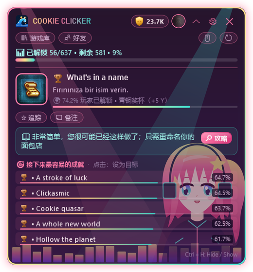

  

  
  
  
  

  <a href="README.md">English</a> · <a href="README.tr.md">Türkçe</a> · <a href="README.ru.md">Русский</a> · <a href="README.es.md">Español</a> · <b>中文</b> · <a href="README.de.md">Deutsch</a> · <a href="README.fr.md">Français</a> · <a href="README.ja.md">日本語</a>

---

**HundoHunter** 是一个在你玩游戏时停在屏幕角落的小窗口。它会自动识别正在运行的 Steam 游戏，告诉你**下一个该拿的成就**、**怎么拿到它**，以及**哪些成就可能永远错过**。目标只有一个：把每款游戏都打到 100%，也就是一个 *hundo*。

而且你从不孤单。来认识一下 **Hundo 们** 吧 💖

  

## 💖 认识 Hundo 们

Hundo 们是住在 HundoHunter 主题里的小女孩。她们会眨眼、摇摆、摇尾巴，**每当你解锁成就时都会开心地跳起来**。每个人都有自己最喜欢的工作：

<table>
<tr>
<td width="200" align="center"> <b>猫娘</b></td>
<td>
<b>追踪者。</b> 游戏一启动，猫娘就能嗅到你的<b>下一个成就</b>，并给出描述和攻略提示。目标接近时她的耳朵会抖动（例如 <code>32/50</code> 进度型成就）。
  <i>"喵~ 再三个就是你的啦！"</i>
</td>
</tr>
<tr>
<td width="200" align="center"> <b>月光</b></td>
<td>
<b>安静的守护者。</b> 月光守护着你的<b>游戏库</b>、<b>14 天历史</b>以及<b>最接近 100%</b> 的游戏，让你随时知道哪个 hundo 触手可及。
  <i>"Stardew Valley 已经 86% 了……今晚把它打完吧？"</i>
</td>
</tr>
<tr>
<td width="200" align="center"> <b>霓虹节拍</b></td>
<td>
<b>啦啦队长。</b> 成就一解锁，她最先知道：<b>即时检测</b>，与 Steam 自己的通知同一秒。奖杯音效、弹窗、跳一跳，你的 <b>Y 分</b>也随之上涨。
  <i>"钻石奖杯！！不到 1% 的玩家拿到过！"</i>
</td>
</tr>
<tr>
<td width="200" align="center"> <b>哥特公主</b></td>
<td>
<b>守卫者。</b> 她会在为时已晚之前提醒你<b>可错过的成就</b>（AI 辅助检测），并把<b>隐藏成就模糊处理</b>，不让任何剧透。
  <i>"小心。离开这一章，那个奖杯就永远没了。"</i>
</td>
</tr>
</table>

## ✨ 功能

<table>
<tr>
<td width="50%" valign="top"></td>
<td valign="top">
<h3> 游戏内攻略</h3>
<ul>
<li>自动识别正在运行的 Steam 游戏</li>
<li>带描述、稀有度和攻略提示的<b>下一个目标成就</b></li>
<li>带稀有度条的<b>最接近的成就</b></li>
<li>追踪任意成就作为目标，添加个人笔记</li>
<li>在<b>无边框 / 窗口化全屏</b>的游戏上方显示</li>
</ul>
<h3> 即时解锁</h3>
<ul>
<li>读取 Steam 自己的本地记录：成就会在 <b>Steam 显示的同一秒</b>出现</li>
<li>即使<i>游戏详情</i>设为私密也能工作</li>
<li>离线缓存：没有网络也能用</li>
</ul>
</td>
</tr>
<tr>
<td valign="top">
<h3> 没有意外，没有剧透</h3>
<ul>
<li><b>可错过成就</b>提醒（AI 辅助：Gemini 或 OpenAI）</li>
<li>攻略文本<b>自动翻译</b>成你的语言</li>
<li><b>防剧透</b>：隐藏成就在你想看之前一直保持模糊</li>
</ul>
<h3> 你的全部收藏</h3>
<ul>
<li>显示每款游戏进度和<b>最接近 100%</b> 的游戏库</li>
<li>14 天解锁历史图表</li>
<li><b>好友比较</b>和好友排行榜</li>
<li>多个 Steam 账号，一键切换</li>
</ul>
</td>
<td valign="top"></td>
</tr>
</table>

  &nbsp;&nbsp;
  

## 🏆 奖杯等级与 Y 分

每个成就会根据解锁玩家比例获得一个等级，每个等级都有自己的音效。

| | 等级 | 解锁比例 | 分数 |
|:-:|---|---|--:|
|  | **铜** | 50% 及以上 | 5 |
|  | **银** | 20% – 50% | 15 |
|  | **金** | 5% – 20% | 40 |
|  | **蓝宝石** | 1% – 5% | 100 |
|  | **钻石** | 低于 1% | 250 |

把一款游戏打到 100% 可获得 **+50 奖励分**。一路晋级：新手 → 铜猎人 → 银猎人 → 金猎人 → 蓝宝石大师 → 钻石大师 → **传奇**。

## 🎨 20 个主题（还有几个秘密主题）

大多数主题都是动态的。Hundo 们住在 **猫娘**、**月光**、**霓虹节拍** 和 **哥特公主** 主题里，她们还有吉祥物朋友。你甚至可以设置**自己的背景图片**，与主题一起显示或单独显示。

  

> 🤫 有些主题不在列表里。传说 Hundo 们只会把密码悄悄告诉真正的猎人……

## 📥 下载与设置

1. 从[最新版本](../../releases/latest)下载 **HundoHunter.zip**，解压到任意位置。
2. 运行 `HundoHunter.exe`。无需安装其他东西：它是一个内置 .NET 的单文件。 *由于应用未签名，Windows 可能会提示“Windows 已保护你的电脑”。点击 **更多信息 → 仍要运行**。*
3. 在 <https://steamcommunity.com/dev/apikey> 免费获取 **Steam Web API 密钥**（域名随便填，例如 `localhost`），并粘贴到设置中。
4. 添加账号：粘贴你的 Steam 个人资料链接、自定义 URL 名称或 17 位 Steam ID。
5. *（可选）* 添加 **Google Gemini**（有免费额度）或 **OpenAI** 密钥，用于可错过成就检测和攻略翻译。
6. 点击 **保存并启动**，从 Steam 启动一款游戏，和你的 Hundo 打个招呼吧。

> 💡 要使用游戏库、历史和好友功能，请把 **Steam → 编辑个人资料 → 隐私设置 → 游戏详情** 设为 **公开**。

### 快捷键

| 按键 | 功能 |
|---|---|
| `Ctrl` + `H` | 显示 / 隐藏窗口 |
| `Ctrl` + `Shift` + `H` | 点击穿透模式（点击会传给游戏） |
| `Ctrl` + `Alt` + `K` | 紧凑模式 |

所有快捷键都可以在设置中修改。

## 🔒 隐私

- API 密钥只为你的 Windows 账户加密保存（Windows DPAPI）。
- Steam 的本地统计文件只会被**读取**，绝不会被修改。
- 背景图片留在你的电脑上，只保存它的位置。
- 没有遥测。HundoHunter 只与 Steam、你选择的 AI 服务和翻译服务通信。

## ❓ 故障排除

| 问题 | 试试这个 |
|---|---|
| 在游戏上方看不到 | 把游戏切换到 **无边框 / 窗口化全屏**。独占全屏无法显示其他窗口。 |
| 无法读取成就 | API 密钥正确吗？*游戏详情* 是公开的吗？ |
| 成就显示有延迟 | Steam 是否在运行？游戏是否通过 Steam 启动？ |
| 识别成了别的游戏 | 在 *手动选择游戏* 中输入游戏的 AppID（商店链接里的数字）。 |
| 窗口不见了 | 按 `Ctrl` + `H` 或点击托盘图标。 |

## 💝 支持 HundoHunter

HundoHunter 免费且用心制作。如果它帮你拿下了一个 hundo，可以请 Hundo 们吃点小零食！每一份支持都能带来新的主题、功能和新的 Hundo。

  
  

## 📜 法律信息与致谢

HundoHunter 是一个独立的粉丝项目，**与 Valve Corporation 或 Steam 无关**。Steam 及 Steam 标志是 Valve Corporation 的商标。游戏和成就数据来自 Steam Web API。

Hundo 们和所有主题图画都是为 HundoHunter 原创的矢量图。“Press Start 2P”字体：CodeMan38，SIL Open Font License 1.1。

  用 💖 制作： <b>Wavemint</b> 
  

